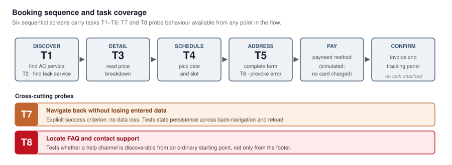
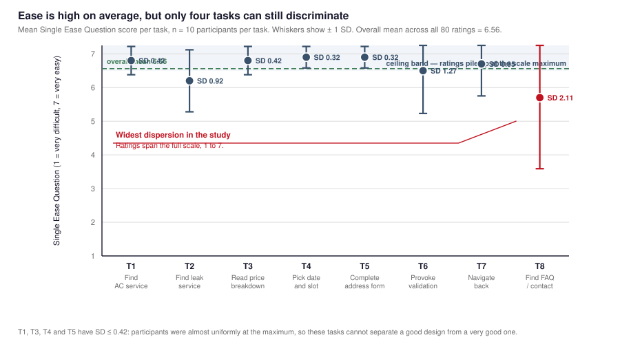

# Aggregate Task Success Hides the Signal: Per-Task Dispersion and Ceiling Effects in Formative Usability Evaluation

**Meutia Braniwati**1 · **Bagaskoro Saputro**2 · **Aditya Paramananda**3 · **Freysia Chandra Saliman**4 · **Stephanie Evangelina Pramudito**5 · **Tan, Michael Wilson Setiawan**6

1BINUS School of Design — Visual Communication Design, Jakarta, Indonesia
2BINUS School of Computer Science — Computer Science
3BINUS School of Information Systems — Information Systems, Jakarta, Indonesia
4BINUS School of Computer Science — Computer Science, Semarang, Indonesia
5BINUS School of Design — Visual Communication Design, Semarang, Indonesia
6BINUS School of Information Systems — Information Systems, Semarang, Indonesia

**Corresponding author:** Meutia Braniwati — meutia.braniwati@binus.ac.id

> **Author roles** (from [`writer.md`](writer.md) and the study contribution record): Meutia Braniwati
> chairs the study and owns the visual branding analysis; Bagaskoro Saputro and Freysia Chandra
> Saliman conducted the usability evaluation; Aditya Paramananda and Tan, Michael Wilson Setiawan
> designed the prototype; Stephanie Evangelina Pramudito handled administration and visual design.
> NIP: Meutia Braniwati **D7003**, Bagaskoro Saputro **6869233**.
>
> Affiliations, byline order and corresponding author are transcribed from [`writer.md`](writer.md).
> `writer.md` records no campus city for Bagaskoro Saputro on this paper.
>
> **Structure:** IMRaD — §1 Introduction, §2 Methods, §3 Results, §4 Discussion, §5 Conclusion.
> Related work is folded into §1.3; threats to validity into §4.3.
> Traceability: [`ut-results-integration.md`](ut-results-integration.md). Submission plan:
> [`PLAN-3-paper-split.md`](PLAN-3-paper-split.md).
> Companion papers: [C2] price-integrity auditing · [J1] barrier typology and remediation.

---

## ABSTRACT

Formative usability studies almost always report an aggregate task-success rate. We argue that this
summary is structurally lossy, and we demonstrate the loss on complete data from a real study rather
than by simulation. Ten participants completed eight standardised tasks across two moderated rounds,
yielding eighty task attempts, Single Ease Question (SEQ) scores on a 7-point scale, and observer
commentary, for a high-fidelity Indonesian-language home-services marketplace prototype.

Aggregate results are strong: **93.75% task success (75/80)** and **mean ease M = 6.56, SD = 1.05**.
We argue both numbers are close to uninformative. Computing dispersion per task shows **four of the
eight tasks saturated at SD ≤ 0.42** — they can no longer distinguish a good design from a very good
one, and further iterations against them consume budget for no return. Only one task, locating the FAQ
and contact channel, produced meaningful spread (**M = 5.70, SD = 2.11**, full 1–7 range), and it is
also the lowest-scoring. A matched pair of discovery tasks isolates a further effect: a well-labelled
category was found without difficulty (M = 6.80, SD = 0.42) while a near-synonymous label drew a 0.60
drop with triple the variance (M = 6.20, SD = 0.92) — separating a taxonomy defect from a layout
defect.

We report that the two instrumented **defect probes (T6, T7) were the only tasks immune to
saturation**, which suggests a practical rule: every formative task set needs at least one probe that
is expected to fail. We recommend that formative evaluation report per-task dispersion and
probe results rather than totals, and we publish the five provenance defects that constrain the
conclusion.

**Keywords:** usability testing, Single Ease Question, ceiling effect, dispersion, formative
evaluation, task success, measurement granularity, Indonesia, think-aloud

---

## 1. INTRODUCTION

### 1.1 Background and motivation

Household maintenance services in Indonesia — air-conditioner cleaning, plumbing leak repair, pump
servicing, septic tank suction — are dominated by micro and small enterprises whose customer
acquisition still runs through spanduk (street banners), printed leaflets, and vehicle stickers [1].
The channel has structural properties that are easy to overlook because they are invisible to the firm
as well as the customer: a fixed physical area, which caps how much information can be presented; no
record of prior work; and no price, which is negotiated privately and therefore unverifiable in
advance.

A web interface removes the area constraint. It does not follow that the resulting interface is good,
and it certainly does not follow that it is measurable. Most formative evaluations report a headline
success rate, and a headline success rate is a lossy summary of a multidimensional, per-task,
per-participant result.

This paper's contribution is to show, on complete real data, **how much a headline success rate can
hide.** We find that a 93.75% success rate coexists with four saturated tasks that can no longer
generate evidence, one task whose ratings span the entire scale, and a service taxonomy that misleads
participants who are otherwise fluent. Our practical recommendation follows directly: **formative
evaluation should report per-task dispersion and defect-probe results, not just totals.**

The barrier taxonomy and remediation backlog built on this study appear in a companion paper [J1]. A
price-integrity finding, which raises a distinct methodological question we deliberately set aside,
appears in [C2].

### 1.2 Research questions

- **RQ1.** With what ease do young adult users complete a standardised service-discovery and booking task
  sequence?
- **RQ2.** Which tasks discriminate between participants, and which are saturated?
- **RQ3.** How can a task instrument be constructed so that some tasks remain informative even when
  the design is strong?

### 1.3 Related work

**Interface design for Indonesian MSME services.** Task-based design and evaluation of e-commerce
interfaces is well established in the Indonesian literature [2], and Tianti et al. [1] demonstrate a
small-business website raising promotional reach for a catering MSME. Sunarso et al. [3] provide
evidence that visual content raises attraction and conversion in MSME digital marketing. We adopt the
underlying premise — consistent visual identity and legible service information signal operational
capability — while declining to import effect sizes measured on different stimuli.

**Formative evaluation instruments and their limits.** The Single Ease Question (SEQ) is a widely
adopted post-task instrument: one 7-point item administered immediately after each task attempt, whose
only requirement is that the task be defined in terms the participant can recognise [4]. We adopt it
for breadth — one comparable number per attempt — while noting a trade-off our own data exposes
sharply (§3.2): SEQ is a *mean* measure, and means conceal precisely the information a formative
study needs. Reporting the mean alone would have led us to describe this prototype as uniformly easy,
which §3.3 shows it is not.

**Measurement granularity.** Our argument is a special case of a general problem in measurement: a
summary statistic computed over heterogeneous items can be dominated by items carrying little
information while masking the items that carry all of it. Ceiling effects are the standard
psychometric term for this, and they are widely discussed in survey research and in adaptive testing,
where item saturation is a known threat to item-response estimation. What appears to be missing from
HCI practice is the routine reporting of dispersion at the *task* level, as opposed to the study
level. We are not aware of a published argument that formative usability reports should compute
per-task variance as a matter of course, which is the gap this paper addresses.

**Matched designs.** A matched pair of tasks differing in exactly one property is a standard
identification strategy: holding everything else constant turns a vague complaint into an
attributable cause (§3.4). We use it here to separate a taxonomy defect from a layout defect, a
distinction that determines whether the remedy is a data change or a redesign.

**Heuristic inspection.** Heuristic inspection [5] and its Indonesian applications [6,7] are
complementary but operate on a different object: the code, not the experience. The convergence
between the two is examined in [C2] and [J1].

### 1.4 Scope and contributions

This is a *formative* evaluation of a single prototype build. No variable measuring conversion,
revenue, bounce rate, cognitive load, or trust change was instrumented, and we make no claim about any
of them. Our contributions are: a per-task dispersion analysis of a complete evaluation; a matched-pair
design that converts a vague complaint into a specific diagnosis; a demonstration that defect probes are
the saturation-immune component of a task instrument; and a candid account of five provenance defects
that constrain the conclusions.

## 2. METHODS

### 2.1 Prototype under test

A high-fidelity React prototype, localised into Indonesian, implementing service discovery with search
and category filtering, service detail pages, a four-stage checkout (summary → schedule → address →
payment), a confirmation/invoice view, technician tracking, and an FAQ/contact area. Two properties
were left unchanged during the study because they are the subject of the research questions: prices
render in **USD** while the interface is Indonesian-language, and service descriptions include
**technician-internal procedure content** intended for engineers rather than customers.

### 2.2 Participants

Ten participants were recruited and tested in two rounds of five, identified only by anonymous codes
(P01–P05, P06–P10). Sessions were conducted in Semarang, Central Java, between **1 and 30 October 2026**.

**Disclosure on demographics.** Participants were Gen Z, aged **19–21**, verified against their national
ID cards by the research team at recruitment and confirmed for all ten. No date of birth was
transcribed into the research data, as a privacy measure; the age range is recorded here as an
aggregate. Gender and occupation were not collected. The sample is therefore described as
*Gen Z users recruited purposively* and we make **no representativeness claim** beyond that
description.

### 2.3 Tasks

Eight tasks spanning the booking flow (Figure 1). T1 and T2 are *matched* discovery tasks differing
only in service category. **T6 and T7 are defect probes** — tasks with explicit failure criteria,
designed so that a correct prototype yields failures rather than successes.

**Figure 1.** The eight-task instrument mapped onto the prototype's booking sequence. Six sequential
screens carry T1–T6; T7 and T8 probe behaviour available from any point in the flow.

| Code | Task | Type |
|---|---|---|
| T1 | Locate the air-conditioner cleaning service | discovery |
| T2 | Locate the leak-detection service | discovery (matched to T1) |
| T3 | Read the detailed price breakdown | comprehension |
| T4 | Select a booking date and time slot | selection |
| T5 | Complete the address form | data entry |
| T6 | Trigger and identify a validation error | **defect probe** |
| T7 | Navigate back without losing entered data | **defect probe** |
| T8 | Locate FAQ / contact support | findability |

### 2.4 Measures and procedure

- **Task outcome:** completed / completed with assistance / not completed, against a written criterion
  per task.
- **SEQ:** 1 = *very difficult* … 7 = *very easy*, immediately after each attempt.
- **Observer commentary:** notes on confusion, verbalised expectations, and unsolicited suggestions.

Sessions were moderated with concurrent think-aloud. Screen and audio recording was conducted with the
consent of all ten participants and is stored under institutional control, scheduled for deletion on
1 January 2027; **the recordings were not used in this analysis**, and all qualitative material
available to it is therefore observer paraphrase, not verbatim transcript. We use quotation marks in
this paper only for source documents, never for participant speech.

### 2.5 The completion-rate dispute, and how we resolved it

Completion was coded during sessions and recorded as 39/40 (round 1) and 40/40 (round 2). Both source
recap sheets then appended an auditor note that specific attempts should have been coded failures:

- **Round 1:** two T6 attempts recorded as successes although the criterion was *find the validation
  message*, and the notes state the participants did not find it.
- **Round 2:** one T6 attempt recorded as a success although the note reads "user did not find any
  error"; another reached confirmation with a street address consisting only of the characters `(` and
  `)`.

This is a genuine interpretive disagreement about whether failure on a *sub-criterion* constitutes task
failure, not an arithmetic error. Rather than adopt either position silently, **we report the
auditor-corrected figures as the headline and present the as-recorded figures as a sensitivity
analysis** (§3.1).

## 3. RESULTS

### 3.1 Task success

| | Round 1 (n=5) | Round 2 (n=5) | Combined (n=10) |
|---|---:|---:|---:|
| **As recorded** | 39/40 (97.5%) | 40/40 (100%) | 79/80 (**98.75%**) |
| **Auditor-corrected (headline)** | 37/40 (92.5%) | 38/40 (95.0%) | 75/80 (**93.75%**) |

All five failures occurred at T6 or T8. A rate above 90% would ordinarily indicate a largely
successful design. **We do not read it that way**, for two reasons. First, the T6 success criterion
was permissive — a permissive criterion inflates the aggregate, so the headline number is an upper
bound on its own reliability. Second, and decisively, success is *ceiling-bound*: four tasks were
near-universally completed, so the metric cannot discriminate between design states (§3.2).

### 3.2 Ease, and why the mean is not the finding

Overall SEQ: **M = 6.56, SD = 1.05** (n = 80 task-level ratings), median 7. Distribution: 62 ratings
of 7, 10 of 6, 4 of 5, 1 of 4, 2 of 3, 1 of 1.

**Figure 2.** Mean SEQ per task with ±1 SD whiskers. Four tasks sit against the scale ceiling with
SD ≤ 0.42. T8 has both the lowest mean and the widest dispersion, spanning the full 1–7 range.

Two observations follow, and **neither is visible in the aggregate mean.**

**(a) Four of eight tasks are saturated.** T1, T3, T4, and T5 have SD ≤ 0.42 on a 7-point scale; for
T4 and T5 no participant rated below 6. These tasks cannot separate a good design from a very good
one, and further iterations must not rely on them for evidence. Reporting only the mean would have
hidden this entirely — and would have invited us to keep iterating on tasks that had already stopped
producing signal.

**(b) T8 is the study's real signal.** Support-channel discoverability has the lowest mean (*M* = 5.70)
*and* by far the widest dispersion (SD = 2.11), spanning the full usable range from 1 to 7. Individual
comments locate the cause precisely: participants found the WhatsApp control and read it as a
*booking* action rather than a *support* channel; some located help only in the footer; one found no
direct contact number at all. Two participants rated T8 at 7; one rated it 1.

**A task whose ratings span the entire scale is under-served by the design, not merely unfamiliar to
the participant.** A wide spread invites the reading "some users need training." The comments refute
it: the mechanism is not comprehension but *labelling and placement* — a control that is present,
visible, and means something other than what it appears to mean.

### 3.3 How many saturated tasks make an instrument uninformative?

The practical question behind §3.2(a) is a counting one, and this study's proportions let us answer it
descriptively. **Four of eight tasks — half the instrument — produced SD ≤ 0.42.** Those four
contributed 32 of 80 observations, and their within-task variance is negligible, so they contribute
almost nothing to the study-level SD of 1.05. The entire reported dispersion is generated by four
tasks: T2, T6, T7, and T8.

This has a direct consequence for instrument design. If a formative study wants per-task dispersion to
carry diagnostic information, then **at least half its tasks must remain discriminative**, or the
study-level variance statistic will be reported as though it described the whole instrument when it in
fact describes a minority of it. A study that reports only M and SD invites the reader to assume
uniform informativeness across tasks. We found that assumption false in half our cases.

We note this is an observation from one study, not a general threshold. The proportion of saturated
tasks depends on instrument difficulty, participant expertise, and design quality. What generalises is
the reporting requirement: **the proportion of saturated tasks should be stated, because it determines
how much of the study-level variance is informative.**

### 3.4 Defect probes are the saturation-immune component

The two tasks designed with explicit failure criteria behaved exactly as intended, and this is the
study's most transferable methodological finding.

| Task | Type | M | SD | Range |
|---|---|---:|---:|---|
| T6 | defect probe | 6.50 | **1.27** | 3–7 |
| T7 | defect probe | 6.70 | **0.95** | 4–7 |
| T1, T3, T4, T5 | ordinary tasks | — | 0.32–0.42 | 6–7 |

Both probes sit far above the four saturated tasks in dispersion, and T6 carries the third-lowest mean
in the instrument. **A probe did not saturate even though the design is strong.** The reason is
structural rather than accidental: an ordinary task asks whether the user can *succeed*, and a
competent prototype lets nearly everyone succeed, which necessarily compresses variance. A probe asks
whether the user can *fail in a specific way*, which a competent prototype permits precisely because
the defect — or the absence of one — is detectable.

We therefore propose a practical rule: **every formative task set should include at least one defect
probe with an explicit failure criterion.** Without one, a study of a strong design has no
instrument that can continue generating evidence, and its remaining tasks will saturate. In our
instrument, adding two probes to six ordinary tasks meant that 4 of 10 task-instances still
discriminated; six ordinary tasks alone would have left us with T2 and T8 only.

### 3.5 The matched pair isolates a taxonomy defect

T1 and T2 are the same task with a different category. T1 (find AC cleaning) reached **M = 6.80,
SD = 0.42**. T2 (find leak detection) reached **M = 6.20, SD = 0.92** — a 0.60-point drop, with
triple the variance, on an otherwise identical task.

Participants attributed the difficulty to near-synonymous service labels ("smart leak detection" versus
pipe inspection) that the interface did not differentiate, and in two cases to the booking control
sitting below the fold. This is a **labelling** problem, not a **layout** problem: the category was
reachable, but participants could not determine *which* entry addressed their problem. The practical
consequence is disproportionate — merging two near-synonymous catalogue entries is a data change,
while redesigning the discovery screen is a redesign.

### 3.6 A contradiction between our own sources

The narrative report's recommendation matrix rates support/contact remediation **Low** priority. Both
recap sheets rate it **High**. The narrative's own session data contradicts its own prioritisation,
since four of its sessions record difficulty locating support. We adopt the recap sheets' rating, on
the grounds that it is supported by the largest weight of recorded evidence and by the dispersion
analysis in §3.2(b). We report the disagreement rather than suppressing it, because a reader checking
our recommendation against the primary documents should be able to see that we noticed.

## 4. DISCUSSION

### 4.1 What worked

The prototype's *structure* is sound. Four tasks sit at or near ceiling with almost no dispersion. The
booking flow follows an expected mental model — browse, detail, schedule, address, pay, confirm — and
participants navigated it without instruction. Participants with e-commerce familiarity recognised the
checkout pattern immediately.

Note the asymmetry in T5: the address form reached ceiling (*M* = 6.90, SD = 0.32) **while generating
the most frequently requested features in the entire study** — geocoding, autocomplete, saved
addresses. The form is easy to fill and wrong in design. **Ease of completion and fitness for purpose
are independent properties, and SEQ measures only the first.**

### 4.2 Methodological recommendations

- **Report per-task dispersion, not just aggregate success.** A 93.75% success rate coexisted here
  with a task rated as low as 1/7 and a Critical pricing defect reported in [C2]. The dispersion
  analysis is what surfaced both.
- **State the proportion of saturated tasks.** It determines how much of the study-level variance is
  informative (§3.3).
- **Include at least one defect probe.** Ordinary tasks saturate on a competent design; probes do not
  (§3.4).
- **Separate tasks that can discriminate from tasks that are saturated.** Four of our eight tasks could
  no longer produce evidence. Continuing to iterate against them would consume budget for no return.
- **Prefer matched task pairs to isolate causes.** The T1/T2 contrast converted a vague complaint
  ("search is hard") into a specific, cheap-to-fix diagnosis (taxonomy, not layout).
- **Treat effortful completion as a smell.** The address form was easy to fill and wrong. Comfort is not
  fitness.

### 4.3 Threats to validity

**T-1 — Participant rosters do not agree across source records. [Severe]** The narrative corpus names
ten participants; the two quantitative recap sheets name a partly different set — four names overlap,
three appear only in the recap sheets, and six narrative participants have no SEQ record anywhere. Both
recap sheets end with a note that missing names be filled in. **Consequence:** the SEQ and narrative
corpora cannot be confirmed to be the same ten people. We never aggregate across them as though they
were.

**T-2 — No build identifier, date, or moderator record. [Severe]** The protocol required recording the
canonical prototype and its build hash before sessions began; no session record contains one. **No
result may be attributed to the current prototype.**

**T-3 — Demographic detail minimal. [Low]** Participants were Gen Z, aged 19–21, verified against
national ID cards at recruitment; no date of birth was transcribed into the research data, and gender
and occupation were not collected. **Consequence:** the sample's composition is established only to the
extent stated, and no claim is made beyond it.

**T-4 — Ethics and consent. [Severe]** Written informed consent was obtained from all ten participants
and the safeguards applied in every session are documented. **No institutional research ethics review was
conducted prior to data collection**, a departure from our own protocol and from BINUS's requirement
that research involving human participants be submitted for determination before recruitment. A
determination has been requested from the Research Ethics Committee under the exemption track for
secondary analysis of deidentified data; the request and a full disclosure of the departure are
documented in [`ethics-request/`](ethics-request/). **Until a written determination is issued, this
threat remains open.** Consent and institutional review are separate requirements, and satisfying the
first does not discharge the second.

**T-5 — Ceiling effect limits four tasks. [Moderate]** T1, T3, T4, T5 (SD ≤ 0.42) cannot discriminate
between design states. Later iterations will need harder tasks, a more complex stimulus, or different
measures.

**T-6 — Variance collapse between rounds. [Moderate]** Round-2 per-task SD (0.49) is 2.8× smaller than
round-1 (1.39), with three participants returning near-uniform maximum scores. Possible causes —
differing scoring discipline, moderator effects, demand characteristics, transcription convention —
cannot be distinguished from the available records. We therefore report the round comparison
descriptively and draw **no** design-effect conclusion from it; the build did not change between rounds.

**T-7 — Qualitative corpus is observer paraphrase, not transcript. [Moderate]** **Consequence:** no
direct quotation is used anywhere in this paper.

**T-8 — Transcription gaps. [Low]** One recap sheet notes that a participant's comments were truncated
in a screenshot and should be checked against the original sheet. Not performed.

**T-9 — References partly unverified. [Low]** See [`reference-audit.md`](reference-audit.md).

## 5. CONCLUSION

We evaluated an Indonesian-language home-services marketplace prototype with ten participants across
eight tasks and two rounds. Task success was 93.75% and mean ease 6.56/7 — and the most useful result
of the study is that **neither number characterises the design.**

Beneath the aggregate sit four saturated tasks that can no longer generate evidence, one task whose
ratings span the entire scale because a help channel is present but mislabelled, and a matched pair
of discovery tasks that isolates a taxonomy defect from a layout defect. The two defect probes were the
only tasks that stayed informative on a competent design, which is why every formative task set should
carry at least one.

The methodological lesson generalises beyond this prototype. **A formative study that reports only
aggregate success rates will systematically under-report exactly the problems that matter most**,
because the tasks that discriminate are outnumbered by the tasks that have saturated. We recommend
publishing per-task dispersion as a matter of course, and we have published ours — including the five
provenance defects that constrain them.

---

---

## ETHICAL CONSIDERATIONS

Written informed consent was obtained from all ten participants before participation began. Participants
were informed of the study's purpose, that the prototype simulated all transactions, and that they could
decline any question or stop at any point without consequence. No identifiable personal data were
collected or retained; session records are held under pseudonymous codes and re-identification is not
possible. Screen and audio recording was a separate opt-in that all ten participants accepted; the
recordings are held under institutional control and scheduled for deletion on 1 January 2027, and were
not used in this analysis. **No institutional research ethics review was conducted prior to data
collection**, a
departure from our own study protocol, disclosed here as a limitation; the safeguards applied are
evidenced by the signed consent instruments held by the corresponding author, and a determination has
been requested from the BINUS Research Ethics Committee under the exemption track for secondary analysis
of deidentified data ([ethics-request/](ethics-request/)). **[If granted: This study was determined to
require no ethical review by the Research Ethics Committee, BINUS University (determination no. [X],
[date]).] [If pending: No determination has been issued as of submission.]** No external funding was
received. The authors declare no competing interests. The complete SEQ matrix and provenance record are
available in the study's repository.
## SHARED-DATASET DISCLOSURE

The ten participants and eighty task attempts reported here are the same dataset used in [C2]
(price-integrity auditing) and [J1] (barrier typology and remediation for MSME service marketplaces).
All three papers draw on one prototype build. The split is thematic, not evidential: **no number is
unique to this paper**, and every figure here appears in one or both companions in some form.

What is unique to this paper: the aggregate-versus-dispersion argument; the saturated-task proportion
(§3.3); the saturation-immunity of defect probes (§3.4); the SEQ instrument and the complete rating
matrix (Appendices A and B); and methodological recommendations only.

Barriers, remediation backlog, and organisational implications appear in [J1]. The price-integrity
finding and its reproduction attempt appear in [C2].

---

## AUTHOR CONTRIBUTIONS

Stated in CRediT terms. Contributions are taken from the study contribution record and should be
confirmed by each author before submission.

| Author | CRediT roles |
|---|---|
| **Meutia Braniwati** | Conceptualization; Project administration; Methodology; Writing – review & editing |
| **Bagaskoro Saputro** | Methodology; Investigation; Formal analysis; Writing – original draft |
| **Aditya Paramananda** | Software; Methodology; Resources; Writing – review & editing |
| **Freysia Chandra Saliman** | Investigation; Data curation; Resources; Writing – review & editing |
| **Stephanie Evangelina Pramudito** | Investigation; Project administration; Resources; Visual design; Writing – review & editing |
| **Tan, Michael Wilson Setiawan** | Software; Resources; Writing – review & editing |

All authors read and approved the final manuscript. Meutia Braniwati and Bagaskoro Saputro are
responsible for the study design and for the analysis reported here.

---

## DATA AVAILABILITY

All data underlying every figure in this paper will be deposited on OSF at **[OSF_LINK — to be added]**.
The deposit contains the complete SEQ matrix (Appendix B), per-task dispersion tables, the source
recap sheets, and the provenance record (Appendix C), all under the pseudonymous participant codes
P01–P10 used here.

Screen and audio recordings are **not** shared. They were not used in this analysis, and they are
scheduled for deletion on 1 January 2027 under the approved consent instrument.

---

## REFERENCES

> **Reference verification notice.** Every reference was checked against `doi.org`, the Crossref API,
> the DataCite API, and the publisher's article page. Method and evidence in
> [`reference-audit.md`](reference-audit.md). Bracketed numbers are **stable identifiers**, not
> renumbered after deletions, so cross-references in earlier drafts still resolve. Sources cited in
> the earlier proposal that could not be verified have been removed and their dependent claims
> withdrawn; they are listed in [`reference-audit.md`](reference-audit.md) and must not be re-added.

[1] Tianti AM, Firmania BN, Prini, Fanani RCP, Putri SE, Adisusilo AK. Peningkatan promosi usaha
catering UMKM melalui pembuatan website berbasis WordPress. PENITI BANGSA. 2024;2(2):01–8.
doi:10.30742/PENITI-BANGSA.v2i22024.177 ✓ verified — corrected from a DOI that does not exist; page
range corrected per the publisher PDF.

[2] Dinata PZ, Urwah MA, Rahmawan MR, Junaeti E. Perancangan UI/UX web e-commerce 'Hallo Coffee'
menggunakan metode *user-centered design*. Jambura J Inform. 2023;5(1):45–58.
doi:10.37905/jji.v5i1.17511 ✓ verified — corrected from a DOI that does not exist; title and DOI
verified at the publisher.

[3] Sunarso B, Tusriyanto, Mustafa F. Analysing the role of visual content in increasing attraction
and conversion in MSME digital marketing. J Contemp Adm Manag ADMAN. 2023;1(3):193–200.
doi:10.61100/adman.v1i3.79 ✓ verified — corrected from a DOI that does not exist. All other fields
exact.

[4] Sauro J, Lewis JR. *Quantifying the user experience: Practical statistics for user research.* 2nd
ed. Sebastopol, CA: Morgan Kaufmann; 2016. ✓ verified

[5] Nielsen J. Enhancing the explanatory power of usability heuristics. Proc ACM CHI'94. 1994:152–8.
doi:10.1145/191666.191729 ✓ verified — Crossref confirms author, title, year, pages, publisher
exactly.

[6] Perdanakusuma AR, Hanggara BT, Hasnanursanti AR. Analisis usability website resmi pemerintah kota
*Surakarta* menggunakan metode heuristic evaluation. J TECNOSCIENZA. 2022;6(2):430–443. **[PARTIAL]**
— title qualifier restored; pages corrected from 429–43 to 430–443 per two independent citing works.
Article confirmed real (Univ. Brawijaya, published 2022-04-05). **The DOI previously given does not
exist and the journal host was unreachable during the audit — supply the correct DOI by hand.**

[7] Febriyanthi A. Interface design heuristic evaluation website yayasan kesehatan Telkom. Turk J Comput
Math Educ TURCOMAT. 2021;12(4):852–859. **[PARTIAL]** — article confirmed real at turcomat.org
(published 2021-04-11). **The DOI previously given does not exist; volume, issue, pages and the second
author's name remain unverified because the publisher returned HTTP 403. Verify by hand.**

[C2] Braniwati M. Price-integrity auditing as a complement to usability evaluation and heuristic
inspection. **Companion paper, same study.** 2026. (Reverse citation — listed for the reader.)

[J1] Braniwati M. A friction typology and remediation matrix for MSME service marketplaces. **Companion
paper, same study.** 2026. (Reverse citation — listed for the reader.)

---

## APPENDIX A — Instrument

> **After completing the task, how easy or difficult was that task for you?**
> 1 = very difficult · 2 · 3 · 4 · 5 · 6 · 7 = very easy

Administered immediately after each of T1–T8. Ordinal scale; mean and SD reported for comparability
with common practice, with the caveat in §4.3(T-5).

## APPENDIX B — Complete SEQ matrix

Participants anonymised per §2.2. Round 1 = P01–P05; Round 2 = P06–P10. Values reproduced exactly as
recorded in the source sheets; recomputation confirmed every reported mean.

| Participant | T1 | T2 | T3 | T4 | T5 | T6 | T7 | T8 | Mean |
|---|---:|---:|---:|---:|---:|---:|---:|---:|---:|
| P01 | 6 | 5 | 7 | 7 | 7 | 7 | 4 | 6 | 6.13 |
| P02 | 7 | 7 | 7 | 7 | 7 | 7 | 7 | 7 | 7.00 |
| P03 | 7 | 5 | 7 | 7 | 7 | 7 | 7 | 3 | 6.25 |
| P04 | 7 | 7 | 7 | 7 | 7 | 7 | 7 | 7 | 7.00 |
| P05 | 7 | 5 | 7 | 7 | 7 | 3 | 7 | 1 | 5.50 |
| P06 | 6 | 6 | 6 | 6 | 6 | 7 | 7 | 5 | 6.13 |
| P07 | 7 | 6 | 7 | 7 | 7 | 7 | 7 | 7 | 6.88 |
| P08 | 7 | 7 | 7 | 7 | 7 | 7 | 7 | 7 | 7.00 |
| P09 | 7 | 7 | 7 | 7 | 7 | 7 | 7 | 7 | 7.00 |
| P10 | 7 | 7 | 6 | 7 | 7 | 6 | 7 | 7 | 6.75 |
| **M** | **6.80** | **6.20** | **6.80** | **6.90** | **6.90** | **6.50** | **6.70** | **5.70** | **6.56** |
| **SD** | 0.42 | 0.92 | 0.42 | 0.32 | 0.32 | 1.27 | 0.95 | 2.11 | 1.05 |

## APPENDIX C — Provenance

Full traceability record — source inventory, roster cross-comparison, recomputed statistics, and the
list of figures permanently barred from this study's reporting — is maintained at
[`ut-results-integration.md`](ut-results-integration.md).

**Prohibited figures.** The superseded draft contained 87.5%, 4.20/5, 84.6%, and 4.23/5. These were
never derivable from any source and remain permanently barred. Note that 84.6% is **not** the
corrected completion rate (93.75%) and 87.5% is **not** any figure in §3.1; the resemblance is
coincidental and must not be used to rehabilitate them.
