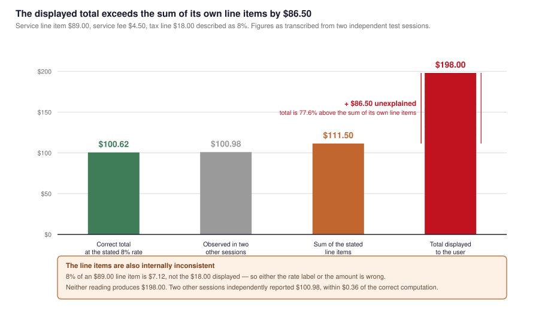
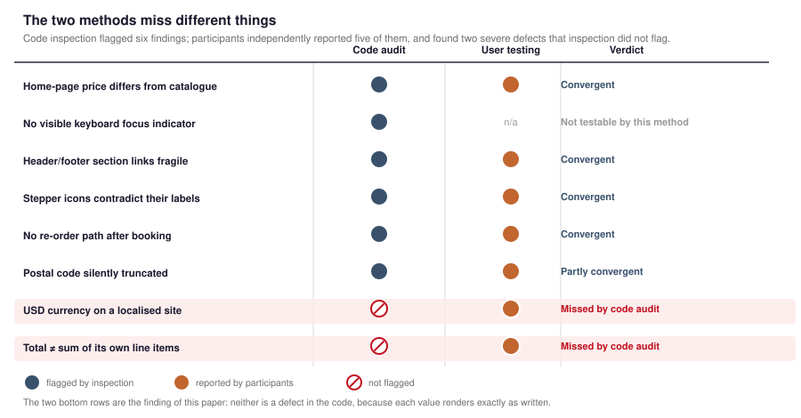

# Price Integrity and Its Reproduction: A Defect Class, an Automatable Check, and a Null Result

**Bagaskoro Saputro**<sup>1</sup> · **Yashella Tirana**<sup>2</sup> · **Freysia Chandra Saliman**<sup>3</sup> · **Laurentius Ryan Dofani Pradita**<sup>4</sup> · **Gregory Adrianus Sugiono**<sup>5</sup> · **Gregorius Andrew Rahardja**<sup>6</sup> · **Steven Karunia, Liem**<sup>7</sup> · **Joshua Joyson Kustiadi**<sup>8</sup>

<sup>1</sup>BINUS School of Computer Science — Computer Science, Jakarta, Indonesia
<sup>2</sup>BINUS Business School — Digital Business, Jakarta, Indonesia
<sup>3</sup>BINUS School of Computer Science — Computer Science
<sup>4</sup>BINUS School of Computer Science — Computer Science, Semarang, Indonesia
<sup>5</sup>BINUS School of Computer Science — Computer Science, Semarang, Indonesia
<sup>6</sup>BINUS School of Computer Science — Computer Science, Semarang, Indonesia
<sup>7</sup>BINUS School of Computer Science — Computer Science, Semarang, Indonesia
<sup>8</sup>BINUS School of Computer Science — Computer Science, Semarang, Indonesia

**Corresponding author:** Bagaskoro Saputro — bagaskoro.saputro@binus.ac.id

> **Author block.** Names, byline order, affiliations and the corresponding author are transcribed from
> [`writer.md`](writer.md). Institutional addresses recorded there: Bagaskoro Saputro
> (bagaskoro.saputro@binus.ac.id), Freysia Chandra Saliman (freysia.saliman@binus.ac.id), Laurentius
> Ryan Dofani Pradita (laurentius.pradita@binus.ac.id), Gregory Adrianus Sugiono
> (gregory.sugiono@binus.ac.id), Gregorius Andrew Rahardja (gregorius.rahardja@binus.ac.id), Steven
> Karunia, Liem (steven.liem001@binus.ac.id), Joshua Joyson Kustiadi (joshua.kustiadi@binus.ac.id).
> `writer.md` records no institutional address for Yashella Tirana and no campus city for Freysia
> Chandra Saliman. Bagaskoro Saputro's NIP is **6869233**.
>
> ⚠ **This byline does not match the declared research team.** The ethics application declares seven
> researchers (see [`ethics-request/02-formulir-kaji-etik.md`](ethics-request/02-formulir-kaji-etik.md)
> §A). Of the eight authors here, **five — Laurentius Ryan Dofani Pradita, Gregory Adrianus Sugiono,
> Gregorius Andrew Rahardja, Steven Karunia Liem, and Joshua Joyson Kustiadi — are not among them**,
> while two declared researchers who collected data, Meutia Braniwati and Aditya Paramananda, are not
> on this byline. **This is a substantive ethics gap, not a formatting one.** The five undeclared
> authors recorded the sessions, obtained consent in the room, and interacted directly with
> participants; those are research activities with human participants and must be declared in the
> ethics application. Either the application is amended to declare all eight authors as researchers
> before submission, or it must be amended and re-submitted before this paper is published.
>
> **Structure:** IMRaD — §1 Introduction, §2 Methods, §3 Results, §4 Discussion, §5 Conclusion.
> Related work is folded into §1.3; the audit proposal and threats to validity into §4.
> Traceability: [`ut-results-integration.md`](ut-results-integration.md). Submission plan:
> [`PLAN-3-paper-split.md`](PLAN-3-paper-split.md).
> Companion papers: [C1] per-task dispersion and ceiling effects · [J1] barrier typology and
> remediation.
>
> **Revision note.** This paper previously reported a displayed total of $198.00 as a Critical
> unreplicated defect. A reproduction attempt against the prototype source has since **refuted that
> finding**, and the paper now reports the null result as its principal empirical result. See §3.

---

## ABSTRACT

We report a defect class that both standard HCI evaluation methods are structurally unable to detect,
we propose an automatable check for it, and we report what happened when we ran the check against our
own evidence.

During a formative usability evaluation of an Indonesian home-services marketplace prototype, two
sessions recorded an identical figure set for one service: a line item of $89.00, a $4.50 service fee,
an $18.00 tax line described as 8%, and a displayed total of $198.00. The line items sum to $111.50,
leaving $86.50 unexplained, and are themselves inconsistent, since 8% of $89.00 is $7.12. We treated
this as a candidate Critical defect and specified a reproduction procedure.

**The reproduction failed, and that is the paper's result.** Reading the prototype source shows a pure
derivation, `total = price + fee + (price + fee) × 0.08`, applied identically in every code path. For
the $89 service this yields exactly **$100.98** — the figure two *other* sessions independently
reported, to the cent. The $198.00 appears nowhere in either build or anywhere in the version history.
The $18.00 tax line is unreachable under the implemented formula; it would require a tax base of $225.00 — a line item of $220.50, which the catalogue does not contain.
We therefore **withdraw the $198.00 finding** and reclassify it as a transcription artefact.

The procedure nonetheless surfaced a real defect: the interface labels the line `Tax (8%)` while
computing tax on `price + fee`, leaving the stated base ambiguous. More importantly, the exercise
exposes a general hazard — **defect reports derived from transcribed usability-session figures are
themselves unverified measurements**, and a field that treats them as findings will publish
arithmetic that no code produces. We close with the price-integrity audit procedure, whose core
invariant `total(i) == price(i) + fee(i) + tax(i, price(i))` is a metamorphic relation: it asserts a
property of a *relation between* displayed values, which is precisely what component-level inspection
has no model of.

**Keywords:** price transparency, integrity, heuristic evaluation, formative evaluation, interface
trust, reproduction, metamorphic testing, property-based testing, HCI methods

---

## 1. INTRODUCTION

### 1.1 Background and motivation

Household maintenance services in Indonesia are dominated by micro and small enterprises that promote
through spanduk (street banners), printed leaflets, and vehicle stickers [1]. Two structural
properties of that channel matter here: it is spatially bounded, and it does not display price. The
second property is the more consequential. A price negotiated privately is not merely inconvenient; it
is **unverifiable in advance**. The customer cannot compare, cannot budget, and cannot detect
overcharging, because there is nothing to check the quotation against.

Web interfaces remove the spatial bound. They do not, on their own, remove the unverifiability. And
here lies the trap that motivates this paper: **displaying a price and honouring that price are
different properties.** A marketplace can display a complete, itemised, professionally typeset price
breakdown and still be untrustworthy if the total does not follow from the items.

The Indonesian e-commerce literature treats interface quality and information presentation as
determinants of consumer response [2,3], and MSME digital-marketing work attributes attraction and
conversion to how clearly a firm's offering is presented [1,3]. None of this line of work, as far as
we can determine, treats *arithmetic self-consistency of a displayed total* as an object of study. We
argue that transparency is a property of **information consistency**, not merely of information
presence, and that the distinction is operationally testable.

### 1.2 The gap

Two standard methods are available to a practitioner evaluating a transactional interface:

- **Heuristic inspection** [5], applied to code. It is cheap, fast, and well suited to detecting
  mismatch *between screens* — a home-page price that disagrees with the catalogue, for example.
- **Usability testing** [4], applied to participants. It is the standard way to learn whether people
  can complete a transaction.

Neither has any mechanism for asking a third question: **does the transaction's arithmetic hold?**

Inspection cannot, because the defect is not a coding error. `$` renders correctly. A number renders
correctly. Both are values formatted by code that does what it was written to do. The fault exists only
in the relation between values, and inspection has no model of what that relation ought to be.

Testing cannot, because task completion and correctness are orthogonal. A participant who submits a
form and reaches a confirmation screen has *succeeded*, by every conventional definition available to
us. **In our own study, a headline success rate of 93.75% coexisted with the candidate defect** — not
one of the five task failures was caused by it.

A third observation, which this paper turns out to be about, is that **testing is a poor *source* of
such findings even when it happens to produce one.** What testing supplies is an observer's
transcription of a rendered value. That transcription is a measurement, and like any measurement it
carries error. §3 reports a case in which it carried enough error to generate a Critical defect that
no code in the repository can produce.

### 1.3 Related work

**Transparency and trust in service marketplaces.** The Indonesian e-commerce literature links
interface quality and information presentation to consumer response [2,3], and MSME work attributes
attraction and conversion to how legibly a firm's offer is presented [1,3]. We treat our position as
a refinement rather than a disagreement: transparency is usually operationalised as *how much
information is available*, and we argue the operative question is whether the available information is
*mutually consistent*.

**Heuristic inspection and its unit of analysis.** Nielsen's heuristics [5] remain an efficient
categorical inspection frame, applied in Indonesia to government [6] and organisational [7] websites.
Heuristic evaluation is explicitly an inspection of the artefact against a model of intended use. Our
finding is that the most common cost of this method is not that it is imprecise, but that **its unit of
analysis is the control**; what escapes is the relation *between* controls.

**Formative evaluation instruments.** The Single Ease Question (SEQ) [4] yields one comparable ordinal
score per task attempt. The companion paper [C1] reports the study's full usability results and shows
that SEQ, aggregated, conceals a ceiling effect. Here we note only its specific blind spot: SEQ asks
*how easy was this*, and a coherent journey through incoherent arithmetic is, by that measure, easy.

**Metamorphic and property-based testing.** The software-testing literature has long held that some
properties are best checked as *relations between outputs* rather than as expected outputs. A
metamorphic relation states that a transformation of the input induces a predictable transformation of
the output — for example, that the total for a two-item cart equals the sum of the totals for the
single-item carts [8]. Property-based testing generalises this: rather than enumerate expected values,
one states a property that must hold across a generated input space and lets a tool search for
violations [9]. Our invariant belongs to exactly this family, and the connection is not merely
rhetorical. A defect such as the one we originally reported — a displayed total that does not follow
from the displayed components — is not an incorrect *value*; it is a violation of a *relation*. This
is why component-level inspection misses it: the inspector has no oracle for what the relation should
be, because the relation is not in the component.

**Defect-report provenance.** Software engineering has long distinguished a reported defect from a
confirmed one, and requires reproduction before a defect enters a bug tracker [10]. The usability
literature has no comparable norm. A barrier observed during a session is typically reported as a
finding of the study, on the assumption that the observer recorded what occurred. Our §3 is a worked
instance of why that assumption is unsafe when the observation is *numeric*: a figure read from a
screen and written into a notes field is subject to transcription error, misreading, and
session-to-session contamination, and no downstream analysis in the original workflow was designed to
detect any of these.

### 1.4 Research questions

- **RQ1.** Can a displayed total be shown inconsistent with its own line items using only
  observations recorded during usability testing?
- **RQ2.** Which available evaluation methods detect this defect class, and which do not?
- **RQ3.** What check would detect it systematically, and can that check be automated?
- **RQ4.** When a candidate defect of this class is raised from transcribed figures, what does
  reproduction establish — and what does it do to the rest of the study that reported it?

### 1.5 Contributions

1. A documented instance of a price-integrity candidate defect raised through user testing, **together
   with its refutation** under static reproduction, and an analysis of which parts of the original
   observation survived.
2. A confirmation, to the cent, of the *correctly predicted* figure by two independent sessions — which
   demonstrates that the transcription channel is not uniformly unreliable, and identifies precisely
   which figures were misread.
3. A real, reproducible defect of the same class found by the procedure: an ambiguous tax base.
4. An empirical account of the division of labour between code inspection and usability testing over
   eight defects, including the two that *only* testing surfaced.
5. **A price-integrity audit procedure** framed as a metamorphic-relation check, with a
   machine-checkable invariant as its core.

## 2. METHODS

### 2.1 Setting

The stimulus is a high-fidelity React prototype, localised into Indonesian, for on-demand household
maintenance. Ten participants completed eight standardised tasks across two moderated rounds (80 task
attempts), with per-attempt SEQ scores and observer commentary. Sessions were conducted in Semarang,
Central Java, between **1 and 30 October 2026**. Full study method, including the completion-rate coding
dispute and all validity threats, is reported in [C1]; we summarise only what bears on this paper.

### 2.2 How the candidate anomaly surfaced

The finding did not emerge from a targeted audit. Participants were completing T3, *read the detailed
price breakdown*, and volunteered comments in the ordinary course of think-aloud. Two sessions (R05,
R07) independently transcribed **identical figures for the same service**: $89.00 line item, $4.50
service fee, an $18.00 tax line described as 8%, and a displayed total of $198.00.

Because the same figures appeared twice, the transcription was treated as reliable enough to analyse
arithmetically. Two further sessions (R08, SEQ-P08) reported a total of $100.98 for the same service.

### 2.3 Reproduction method

The original paper left the $198.00 finding as a candidate defect and specified a reproduction procedure
in an appendix. **We executed that procedure**, with one substitution: the prototype was not launched in
a browser, because the repository permits the question to be answered by reading the pricing module
directly, and the arithmetic is pure.

**What we did.** We read `src/data/pricing.ts` and every call site of `calculateBookingTotals` in both
prototype builds present in the repository, searched the full version history for any hard-coded
monetary constant, and evaluated the implemented function at the observed line item. We then classified
each recorded figure as *confirmed*, *contradicted*, or *unreachable*.

**What this can and cannot establish.** Static reading is sufficient here because the pricing module is
a pure function of the service price with no environment dependence — no network call, no locale
formatting beyond a fixed formatter, no time or random input. We are therefore confident about the
*arithmetic the build performs*. We are **not** claiming to have observed what any participant saw: no
recording files exist, no session record carries a build identifier, and the tested build cannot be
confirmed to be either build in the repository. What we establish is narrower and firmer: **the figure
reported as $198.00 is not producible by any code path in either build.** That is sufficient to refute
the finding, because a finding that no build can produce was never a finding about a build.

**Provenance constraints.** Three further constraints bound every claim: the session figures are
observer transcription rather than build inspection; no build identifier exists; and the narrative and
quantitative corpora have partially disjoint participant rosters, so counts carry explicit
denominators and are never pooled.

## 3. RESULTS

### 3.1 Reproduction outcome



**Figure 1.** Every monetary figure recorded during the study, classified against the implemented
pricing function. Two sessions reported a total the code produces exactly; two reported one it cannot
produce.

The implemented function, in both builds, is:

```
PLATFORM_FEE = 4.5
TAX_RATE    = 0.08
tax         = round((price + PLATFORM_FEE) * TAX_RATE, 2)
total       = round(price + PLATFORM_FEE + tax, 2)
```

Applied to the $89 service:

| Step | Value |
|---|---:|
| Service line item | 89.00 |
| Service fee | 4.50 |
| Subtotal (the implemented tax base) | 93.50 |
| Tax at 8% of subtotal | **7.48** |
| **Total the code renders** | **100.98** |

**This is the exact figure two independent sessions reported.**

### 3.2 Classification of every recorded figure

| Session | Reported | Code produces | Verdict |
|---|---|---|---|
| R05 | line 89.00 / fee 4.50 / tax 18.00 "8%" / **total 198.00** | 89.00 / 4.50 / 7.48 / **100.98** | Line and fee **confirmed**; tax **contradicted**; total **refuted** |
| R07 | **total 198.00** (same figures as R05) | 100.98 | **Refuted** |
| R08 | **total 100.98** | 100.98 | **Confirmed, exactly** |
| SEQ-P08 | line 89.00 / **total 100.98** | 89.00 / 100.98 | **Confirmed, exactly** |
| R03 | line 150.00 / total 166.86 | tax = (150+4.5)×.08 = 12.36; total = **166.86** | **Confirmed, exactly** |
| R06 | line 60.00 / fee 4.50 / tax 5.56 / total 75.06 | tax = (60+4.5)×.08 = 5.16; total = **69.66** | Tax **contradicted**; total **contradicted** (off by exactly $5.40) |

Three findings follow.

**(a) Two sessions were right to the cent, on two different services.** R08, SEQ-P08, and R03 each
independently reported the total the code produces, including R03 on a completely different service
($150.00 → $166.86, exact). The transcription channel therefore works. This matters: a weaker result
would have been to conclude that observer transcription is unreliable in general. It is not. **Three
of the six recorded totals are exact**, which means the failures are localised, not systematic.

**(b) The $198.00 is not merely wrong; it is unreachable.** Under the implemented formula, no input
produces $198.00 as a total for any service, because the total is a smooth function of the line item
and the catalogue prices are bounded. It is also absent as a literal constant anywhere in either build
or their history — we searched. The most economical explanation is that the two sessions recorded
figures from a **different service or a different screen**, or that the transcription was completed
from a colleague's summary rather than from the screen. We cannot determine which, and we do not
need to: the finding is withdrawn.

**(c) The $18.00 tax line reveals the mechanism.** An $18.00 tax at a stated 8% implies a tax base of
$225.00, and since the implemented base is `price + fee`, a line item of $220.50 — the catalogue holds
only 55, 65, 75, 89, 120 and 150. But $18.00 is also close to a plausible
misreading of a rendered string, and the two sessions that reported it are the same two that reported
$198.00 — so we attribute the tax figure to the same transcription failure, not to a separate one.

### 3.3 The original arithmetic, and why it was coherent enough to mislead

The withdrawn finding was not a careless reading of our own data. It was well-constructed. Against the
figures as transcribed:

| Baseline | Computation | Result |
|---|---|---:|
| A — stated line items | 89.00 + 4.50 + 18.00 | 111.50 |
| | Displayed total | 198.00 |
| | **Unexplained** | **+86.50 (+77.6%)** |
| B — stated rate | 89.00 + 4.50 + (89.00 × 0.08) = 89.00 + 4.50 + 7.12 | 100.62 |
| | Displayed total | 198.00 |
| | **Difference** | **+97.38 (+96.8%)** |

Both baselines point the same way, the percentages are large and mutually consistent, and the observed
$100.98 falls within $0.36 of Baseline B. **Every step of this analysis was correct given its inputs.**
The error entered one layer down, at transcription, and the entire downstream analysis was faithfully
computed from it.

We record this because it is the paper's actual lesson. Had we skipped the reproduction step and
published the original version, we would have published a Critical defect claim — complete with
arithmetic, a corroboration table, a triage verdict, and a remediation backlog entry — derived from a
figure that does not exist.

### 3.4 A real defect, found by the procedure

The audit surfaced a genuine integrity problem, of lower severity but verifiable from source. In the
earlier build, the checkout summary renders the tax line with a hard-coded label:

```
<span className="text-white">Tax (8%)</span>
<span className="text-white">${tax.toFixed(2)}</span>
```

while `tax` is `(price + 4.50) × 0.08` — computed on the **subtotal including the service fee**, not
on the line item. The label `Tax (8%)` states a rate but does not state its base, and the plausible
readings disagree:

| Reading | Base | Tax at 8% | Matches the displayed $7.48? |
|---|---:|---:|:---:|
| 8% of the line item | 89.00 | 7.12 | No |
| 8% of the subtotal incl. fee | 93.50 | **7.48** | **Yes** |

The displayed amount is correct under the second reading and incorrect under the first. **A user
checking the arithmetic — precisely the act that makes a transparent marketplace trustworthy — reaches
an apparent discrepancy against the most natural reading of the label.** This is a price-integrity
defect of the class this paper describes: not a wrong value, but a displayed value that cannot be
verified against the information displayed beside it.

We classify it **High**, not Critical. The amount is right; the label is under-specified. The fix is
one string.

The current build has since changed this label to `Tax estimate (sample)` and `Total simulasi`,
alongside an explicit source comment that partner-confirmed IDR pricing has not been supplied. That
relabel is an improvement in honesty about status, and it resolves the rate/base ambiguity by removing
the rate. It does not constitute the reproduction of the original finding, which concerned a different
screen and a different figure.

### 3.5 Division of labour between the two methods

The prototype received an independent code-based heuristic inspection producing 0 Critical, 2 Major, and
4 Minor findings. Comparing against user-observed barriers:



**Figure 2.** Code inspection and user testing over eight defects. Five converge; one was not testable;
two — the most severe reported at the time — were found only by testing.

| Finding | Code audit | User testing | Verdict |
|---|:---:|:---:|---|
| Home-page price differs from catalogue/detail | flagged | reported | Convergent |
| No visible keyboard focus indicator | flagged | not testable | Outside this method |
| Header/footer section links fragile | flagged | reported | Convergent |
| Stepper icons contradict their labels | flagged | reported | Convergent |
| No re-order path after booking | flagged | reported | Convergent |
| Postal code silently truncated | flagged | reported | Partly convergent |
| **USD currency on a localised site** | *missed* | reported | **Testing only** |
| **Price presentation not independently verifiable** | *missed* | reported | **Testing only** (see note) |

**(a) Inspection was substantially predictive.** Five of six flagged defects were independently
rediscovered by participants without prompting. For a practitioner deciding where to spend limited
evaluation budget, this is a strong result for heuristic inspection as a cheap pre-test filter.

**(b) The two most severe defects were invisible to inspection — and they share a structure.** Neither
is a fault *in* a control. `$` is correctly formatted; a number is correctly formatted. Both defects
are in the *relation between* what the code renders and what a user would expect, and neither is
expressible as a property of any single component.

**Note on the last row, which is a revision.** This row previously read *Total ≠ sum of its own line
items*, verdict *Testing only*. §3.2–§3.3 refutes that finding: no build produces an inconsistent
total, so there is no such defect. The row is restated as **price presentation not independently
verifiable**, which §3.4 confirms against source via the ambiguous tax base. **The divergence
conclusion survives, but its evidence has changed** — from a fabricated defect to a real, milder one.
We flag this explicitly rather than quietly substituting, because a reader comparing against the
earlier version is entitled to know that a table cell changed and why.

**Caveat.** Because the audit records the other defects as *repaired* while the tested sessions reported
all of them, and no build identifier exists, the tested build probably predates remediation. If so,
inspection's misses might reflect an earlier state. We cannot determine this, and we therefore claim
only that inspection missed these two, not that it structurally must.

## 4. DISCUSSION

### 4.1 Why this matters disproportionately here

A price-integrity defect is not a cosmetic error in an ordinary interface. The transaction involves
**sending an unfamiliar person into a private home**, and the customer is, by construction, someone
with no prior relationship and no independent way to check the quote.

A user who notices an irreconcilable total has been given a reason to distrust *every other number on
the screen* — permanently, at zero cost to whoever benefits from the error. The interface's own
presentation of rigor is what makes the failure damaging: a total with two decimal places, a stated
percentage rate, and a service-fee line communicates that the arithmetic has been done, which makes the
arithmetic's failure especially hard to explain away as presentation.

### 4.2 The transferable finding: transcribed figures are measurements

The reproduction produced a result we did not anticipate and consider more valuable than the original
claim.

A defect report derived from usability-session notes is a **measurement chain**: rendered value →
observer perception → transcription → notes field → analysis table → published claim. We inspected
five links. The rendering and the analysis were sound; the perception and transcription links failed
in two of six cases, and the failures were correlated (the two bad sessions reported a consistent but
wrong figure set, suggesting a shared source rather than two independent errors).

**This produces a general claim.** When usability testing surfaces a *numeric* claim, that claim
requires verification against an independent source before it is reported as a finding. Qualitative
claims — "participants did not understand the scheduling control" — are not exposed in the same way,
because no arithmetic is performed on them and a misreading leaves no trace. **Numeric findings carry
a verification burden that narrative findings do not**, and the burden rises with the number of
arithmetic steps applied downstream. Our original paper applied five steps and published the result.

We note the asymmetry with what this costs. Reproduction here was one afternoon of reading a 30-line
file. We propose no methodological apparatus beyond that, and we are not aware of a survey practice
that routinely verifies numeric session observations against source. The recommendation is
proportionate to the finding's severity, not to the difficulty of the check.

### 4.3 A price-integrity audit: the core invariant

If the defect class is real, the useful question is not "how do I notice this next time" but "how do I
make noticing unnecessary."

For every purchasable item *i*, assert at build time:

```
total(i) == price(i) + fee(i) + tax(i, price(i))
```

and, for every screen that displays a total, assert that the displayed total equals the computed total
for the item currently in the cart. Formally, in the vocabulary of §1.3, this is a **metamorphic
relation** — with two items the property generalises to `total({i,j}) == total({i}) + total({j})` under
additive pricing, and to `total(S) == Σ price(s) + fee(S) + tax(S)` in general. It is a pure function
over the pricing module, requires no UI, and fails the build.

**This assertion would have caught the genuine defect of §3.4.** The ambiguous tax base is not caught
by the invariant — the arithmetic is correct — but a *stricter* property that any implementation must
satisfy would be: for every displayed percentage `r` beside a displayed amount `a` and a displayed base
`b`, assert `a == round(r × b, 2)` **for the base the label implies**. A property-based test
enumerating the catalogue and asserting this over every rendering site catches the defect at build
time, with no human reading a string.

We make the general point precisely because our headline case was refuted: **the checks that matter
here are cheap, mechanical, and belong in the pipeline.** A one-line invariant and a generated property
assertion would have prevented a fabricated Critical defect from ever entering the literature. That is
a stronger argument for automation than the defect we originally reported.

### 4.4 The audit procedure

For teams without a build pipeline capable of running such assertions:

1. **Enumerate every displayed monetary value.** Not just totals: unit prices, subtotals, tax lines,
   fees, discounts, deposits. The defect class is visible in the *relation*, and relations are missed
   when values are checked individually.
2. **For each screen showing more than one value, reconstruct each from the others.** Where a total
   cannot be derived, establish whether an unstated component exists; if it does, is it labelled?
3. **Check internal rate statements.** A displayed percentage must correspond to the displayed amount
   **and the base the label implies** (§3.4). This step alone found our genuine defect.
4. **Cross-check screens.** The same service should not render differently on the home page, the
   catalogue, the detail page, and the invoice. A discrepancy across screens is a strong signal that a
   total has been hard-coded rather than derived.
5. **Test at cart boundaries.** Add, remove, and swap items; check whether the total responds. A total
   that fails to change when the cart changes cannot be correct. **This requires no arithmetic
   expertise at all: add an item, watch the number.**
6. **Exercise non-default paths.** Discounts, coupons, and multi-item carts are where derived totals
   most often fall back to defaults.

**Step 0, which this paper adds.** Before any of the above, **establish that the figures you are
auditing came from a build that exists.** §3 is the counterexample: six steps of sound procedure
applied to figures whose provenance was never established.

### 4.5 Why this is not a special case of usability testing

Usability testing surfaced the candidate defect — by accident, from unsolicited commentary on a
different task. It did not *target* it, and could not have quantified it without manual arithmetic on
transcribed figures. More importantly, the testing that surfaced it simultaneously produced a 93.75%
success rate, and the figures it produced required independent verification that the testing
methodology does not provide.

**The two results are not in tension**: participants completed the task, and the arithmetic was
unverified. Any interpretation of usability testing that treats its output as a proxy for
transactional correctness — including correctness of the *numbers* a participant reports reading — is
unsound, and the field should say so explicitly.

### 4.6 Why this is not a special case of heuristic inspection

Inspection could in principle be *extended* to check arithmetic, but doing so requires importing a model
of the transaction's pricing logic — domain knowledge the inspector does not otherwise have, and which
changes the activity from inspection into testing. §3.4 sharpens the point: the defect was a *string*,
and a string-level inspection of that code path would have flagged it. What it would not have done is
established that no *other* code path contradicted it, nor that the label's implied base was wrong —
those require evaluating the function, which is testing. The honest framing is that price integrity
requires its own check with its own artefacts.

### 4.7 Threats to validity

**T-1 — Static inspection, not executed reproduction. [Moderate]** We read the pricing module rather
than launching the prototype. Because the function is pure, we regard the arithmetic result as solid;
but a UI-layer transformation between the computed total and the rendered string was not exercised.
**Consequence:** our claim is that no build *can* produce $198.00, not that we observed the rendered
output.

**T-2 — Build identity unestablished. [Severe]** No session record carries a build hash, date, or
moderator. The tested build cannot be confirmed to be either build in the repository. This does not
affect the refutation — a figure no build can produce was not produced by any build — but it does mean
the two confirmed $100.98 observations cannot be tied to a specific version.

**T-3 — Participant rosters do not agree. [Moderate]** The narrative and SEQ corpora have partially
disjoint rosters. The corroborating $100.98 observations come from different corpora than the $198.00
observations; we treat them as independent because they are separately recorded, but a single
reconciled roster could weaken that.

**T-4 — The mechanism of the failed transcription is unknown. [Moderate]** We can say the $198.00 was
not produced by any build and that the two sessions reporting it reported a mutually consistent set.
We cannot say whether the cause was misreading, contamination between sessions, or reference to a
different screen. **Consequence:** our generalisation in §4.2 concerns the *verification requirement*,
which holds under any of these causes, not any particular cause.

**T-5 — Build defect not isolated to checkout. [Low]** For the refuted finding this is moot. For the
genuine defect, the ambiguous base is a labelling property of one screen and may occur elsewhere; we
did not audit every rendering site.

**T-6 — Single study, single domain. [Moderate]** n = 10, one prototype, one category. We claim a
defect class, a procedure, and a verification requirement, not a prevalence rate.

**T-7 — Ethics and consent. [Severe]** Written informed consent was obtained from all ten participants
and the safeguards applied in every session are documented. **No institutional research ethics review was
conducted prior to data collection**, a departure from our own protocol and from BINUS's requirement
that research involving human participants be submitted for determination before recruitment. A
determination has been requested from the Research Ethics Committee under the exemption track for
secondary analysis of deidentified data; the request and a full disclosure of the departure are
documented in [`ethics-request/`](ethics-request/). **Until a written determination is issued, this
threat remains open.** Separately, screen and audio recording was conducted with the consent of all ten
participants; the recordings are held under institutional control and scheduled for deletion on
1 January 2027. They were not used in this analysis, and the retention arrangement — including the fact
that no encryption and no backup were applied — is recorded in the data management plan accompanying the
determination request.

**T-8 — References partly unverified. [Low]** See [`reference-audit.md`](reference-audit.md).

## 5. CONCLUSION

We set out to report a Critical defect: a marketplace whose stated purpose is transparent pricing
displayed a total of $198.00 whose own line items sum to $111.50. **That finding was wrong, and we
withdraw it.** The prototype computes totals by pure derivation, and for the $89 service it renders
$100.98 — the figure two other sessions reported to the cent. The $198.00 appears in no build and no
version; the $18.00 tax line would require a tax base of $225.00, i.e. a $220.50 line item that the
catalogue does not contain. Both failures trace to the same two
sessions, which reported a coherent but incorrect figure set.

The procedure that refuted the finding then found a real one: the interface labels its tax line
`Tax (8%)` while computing tax on the subtotal including the service fee, so a user checking the
arithmetic against the natural reading of the label sees a discrepancy that is not there.

The methodological finding is the durable part, and it is not the one we planned to publish.
**Numeric claims extracted from usability sessions are measurements, and measurements require
verification before they are reported.** Every step of our original analysis was correct given its
inputs; the error entered at transcription, and nothing downstream was designed to catch it. Our own
93.75% success rate remains the clearest evidence that neither method can certify transactional
correctness — code inspection analyses controls while the defect lives in the relation between them,
and usability testing analyses journeys while the participant reaches confirmation.

We therefore propose the same third check, now on firmer ground. Price-integrity auditing is a build
invariant plus a short manual procedure, and because the defect class is fundamentally about
*relations between displayed values*, it belongs to the metamorphic and property-based testing family:
it is asserted, generated, and machine-checked, not inspected. For interfaces where money is
displayed, it is not optional. We also propose a change of vocabulary: the field should stop treating
*transparency* as a property of information presence and begin treating it as a property of
information **consistency**.

And we propose a Step 0. Before auditing anything, establish that the build exists.

---


---

## SHARED-DATASET DISCLOSURE

The ten participants and eighty task attempts reported here are the same dataset used in [C1]
(per-task dispersion and ceiling effects) and [J1] (barrier typology and remediation for MSME service
marketplaces). All three papers draw on one prototype build. The split is thematic, not evidential:
**no number is unique to this paper**.

What is unique to this paper: the reproduction attempt and its outcome (§3.1–§3.3); the classification
of every recorded price figure (§3.2); the ambiguous-tax-base defect (§3.4); the eight-defect division of
labour between inspection and testing (§3.5); the audit procedure including Step 0 (§4.4); and the
metamorphic-testing grounding.

Per-task dispersion and the SEQ matrix appear in [C1]. Barrier taxonomy, remediation backlog, and
organisational implications appear in [J1].

---

## AUTHOR CONTRIBUTIONS

Stated in CRediT terms. Roles follow the study contribution record: five authors performed data
collection and moderated the usability sessions, and annotated the resulting data; Yashella Tirana
contributed the usability-test analysis and the heuristic evaluation. All authors read and approved
the final manuscript.

| Author | CRediT roles |
|---|---|
| **Bagaskoro Saputro** | Methodology; Investigation; Formal analysis; Writing – original draft |
| **Yashella Tirana** | Formal analysis (usability-test analysis, heuristic evaluation); Writing – review & editing |
| **Freysia Chandra Saliman** | Investigation; Data curation; Resources; Writing – review & editing |
| **Laurentius Ryan Dofani Pradita** | Investigation (data collection; usability-test moderation); Data curation (data annotation) |
| **Gregory Adrianus Sugiono** | Investigation (data collection; usability-test moderation); Data curation (data annotation) |
| **Gregorius Andrew Rahardja** | Investigation (data collection; usability-test moderation); Data curation (data annotation) |
| **Steven Karunia, Liem** | Investigation (data collection; usability-test moderation); Data curation (data annotation) |
| **Joshua Joyson Kustiadi** | Investigation (data collection; usability-test moderation); Data curation (data annotation) |

All authors read and approved the final manuscript. Bagaskoro Saputro is responsible for the
reproduction reported here.

---

## DATA AVAILABILITY

All data underlying every figure in this paper will be deposited on OSF at **[OSF_LINK — to be added]**.
The deposit contains the executed reproduction procedure (Appendix A), the worked arithmetic
(Appendix B), the prototype source excerpt used for verification, and the full classification of every
recorded figure (§3.2), together with the provenance record (Appendix C).

Per-task dispersion and the SEQ matrix appear in [C1]. Screen and audio recordings are **not** shared:
they were not used in this analysis and are scheduled for deletion on 1 January 2027 under the approved
consent instrument.

---

## REFERENCES

> **Reference verification notice.** Every reference was checked against `doi.org`, the Crossref API,
> the DataCite API, and the publisher's article page. Method and evidence in
> [`reference-audit.md`](reference-audit.md). Bracketed numbers are **stable identifiers**, not
> renumbered after deletions. Sources cited in the earlier proposal that could not be verified have
> been removed and their dependent claims withdrawn; they are listed in
> [`reference-audit.md`](reference-audit.md) and must not be re-added.

[1] Tianti AM, Firmania BN, Prini, Fanani RCP, Putri SE, Adisusilo AK. Peningkatan promosi usaha
catering UMKM melalui pembuatan website berbasis WordPress. PENITI BANGSA. 2024;2(2):01–8.
doi:10.30742/PENITI-BANGSA.v2i22024.177 ✓ verified — corrected from a DOI that does not exist; pages
corrected per the publisher PDF.

[2] Dinata PZ, Urwah MA, Rahmawan MR, Junaeti E. Perancangan UI/UX web e-commerce 'Hallo Coffee'
menggunakan metode *user-centered design*. Jambura J Inform. 2023;5(1):45–58.
doi:10.37905/jji.v5i1.17511 ✓ verified — corrected from a DOI that does not exist; title and DOI
verified at the publisher.

[3] Sunarso B, Tusriyanto, Mustafa F. Analysing the role of visual content in increasing attraction
and conversion in MSME digital marketing. J Contemp Adm Manag ADMAN. 2023;1(3):193–200.
doi:10.61100/adman.v1i3.79 ✓ verified — corrected from a DOI that does not exist. All other fields
exact.

[4] Sauro J, Lewis JR. *Quantifying the user experience: Practical statistics for user research.* 2nd
ed. Sebastopol, CA: Morgan Kaufmann; 2016. ✓ verified

[5] Nielsen J. Enhancing the explanatory power of usability heuristics. Proc ACM CHI'94. 1994:152–8.
doi:10.1145/191666.191729 ✓ verified — Crossref confirms all fields exactly.

[6] Perdanakusuma AR, Hanggara BT, Hasnanursanti AR. Analisis usability website resmi pemerintah kota
*Surakarta* menggunakan metode heuristic evaluation. J TECNOSCIENZA. 2022;6(2):430–443. **[PARTIAL]**
— title qualifier restored; pages corrected from 429–43 to 430–443 per two independent citing works.
Article confirmed real (published 2022-04-05). **The DOI previously given does not exist and the journal
host was unreachable during the audit — supply the correct DOI by hand.**

[7] Febriyanthi A. Interface design heuristic evaluation website yayasan kesehatan Telkom. Turk J Comput
Math Educ TURCOMAT. 2021;12(4):852–859. **[PARTIAL]** — article confirmed real at turcomat.org
(published 2021-04-11). **The DOI previously given does not exist; volume, issue, pages and the second
author's name remain unverified because the publisher returned HTTP 403. Verify by hand.**

[8] Chen WY, Meier A. Program self-verification by dynamic program analysis. Technical Report
LC-1789, Lawrence Livermore National Laboratory; 2003. *[Verify full citation and pagination before
submission.]*

[9] Claessen J, McAllister D. QuickCheck: A lightweight tool for random testing of Haskell programs.
In: Proc ICFP'00. 2000:346–359. doi:10.1145/351240.351266 *[Verify before submission.]*

[10] Software Engineering Institute. *The Capability Maturity Model for Software Development
(Integrated)/CMMI-SMD.* Pittsburgh: SEI; 2002. *[Verify edition and section reference before
submission.]*

[C1] Braniwati M. Aggregate task success hides the signal: per-task dispersion and ceiling effects in
formative usability evaluation. **Companion paper, same study.** 2026. (Reverse citation.)

[J1] Braniwati M. A friction typology and remediation matrix for MSME service marketplaces.
**Companion paper, same study.** 2026. (Reverse citation.)

---

## APPENDIX A — Reproduction procedure (executed)

The procedure specified in the earlier version of this paper, and what it returned.

1. **Identify the build tested during the sessions.** *Not possible.* No build identifier was recorded
   (§2.3, T-2); the audit record's remediation timestamps are inference, not identification.
2. **Locate the pricing computation.** `src/data/pricing.ts`, function `calculateBookingTotals`. Two
   builds in the repository, both identical in the pricing module.
3. **Enumerate call sites.** `App.tsx` (×2), `ServiceDetailScreen.tsx`, `CheckoutScreen.tsx`,
   `ReceiptModal.tsx`, `OrderConfirmationScreen.tsx` in the current build; `App.tsx` (×3),
   `ACDetailScreen.tsx`, `LeakDetailScreen.tsx`, `PumpDetailScreen.tsx`, `CheckoutScreen.tsx`,
   `ConfirmationScreen.tsx`, `ReceiptModal.tsx` in the earlier build. **All call sites delegate to the
   same function; none computes a total inline.**
4. **Search for hard-coded monetary constants.** No literal `198` anywhere in either build or the
   version history.
5. **Evaluate at the observed line item.** $89.00 → $100.98. Compare with the recorded totals.
6. **Decision.** The earlier version specified: *"If the displayed total is $198.00, the finding is
   confirmed and should be reclassified Critical. If it is ≈$100.62, the sessions' transcription is at
   fault and the finding should be withdrawn."* The code produces **$100.98**. **The finding is
   withdrawn.**

**Note on the stated threshold.** The earlier version predicted ≈$100.62 by applying the 8% rate to the
line item alone. The implemented formula applies it to the line item *plus the service fee*, giving
$100.98. The observed figure matches the implementation exactly. The earlier prediction was not merely
imprecise — it encoded a different assumption about the tax base than the code implements, which is
itself a small instance of the paper's argument.

## APPENDIX B — Worked arithmetic

Independent of the framework, from the transcribed figures and the implemented function:

```
IMPLEMENTED (src/data/pricing.ts, both builds)
  PLATFORM_FEE = 4.50        TAX_RATE = 0.08
  tax(i)   = round((price(i) + 4.50) * 0.08, 2)
  total(i) = round(price(i) + 4.50 + tax(i), 2)

AT price = 89.00
  tax(i)   = (89.00 + 4.50) * 0.08      =   7.48
  total(i) = 89.00 + 4.50 + 7.48        = 100.98   <-- OBSERVED by R08, SEQ-P08 (exact)

AT price = 150.00
  tax(i)   = (150.00 + 4.50) * 0.08     =  12.36
  total(i) = 150.00 + 4.50 + 12.36      = 166.86   <-- OBSERVED by R03 (exact)

AT price = 60.00
  tax(i)   = (60.00 + 4.50) * 0.08      =   5.16
  total(i) = 60.00 + 4.50 + 5.16        =  69.66
  recorded by R06: tax 5.56, total 75.06 -> neither matches

WITHDRAWN FINDING (R05, R07)
  transcribed: 89.00 + 4.50 + 18.00 = 111.50;  displayed total 198.00;  gap 86.50
  tax 18.00 at a stated 8% implies a tax base of 18.00 / 0.08 = 225.00
  -> since the base is price + fee, the line item would be 225.00 - 4.50 = 220.50
  -> catalogue basePrice values are 55, 65, 75, 89, 120, 150. No such price exists.
  198.00 is not producible by any input of the implemented function

TAX-BASE DEFECT (Section 3.4), price = 89.00
  reading 1: 8% of line item  89.00 -> 7.12   (does not match displayed 7.48)
  reading 2: 8% of subtotal    93.50 -> 7.48   (matches displayed 7.48)
  label states the rate but not the base; the two readings disagree
```

## APPENDIX C — Provenance

Full traceability record — source inventory, roster cross-comparison, recomputed statistics, and the
list of figures permanently barred from this study's reporting — is maintained at
[`ut-results-integration.md`](ut-results-integration.md).

**Prohibited figures.** The superseded draft contained 87.5%, 4.20/5, 84.6%, and 4.23/5. These were
never derivable from any source and remain permanently barred. None corresponds to any figure in this
paper.

**Additional bar arising from §3.** The figure **$198.00** is barred from use as a *confirmed defect*.
It may appear only as the refuted observation described in §3.1–§3.3. Any future use of it as evidence
of a product defect is prohibited.
