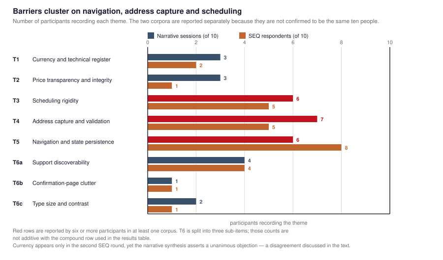

# Interface Friction as a Constraint on Market Participation: A Typology and Remediation Matrix for MSME Service Marketplaces

**Bagaskoro Saputro**1 · **Yashella Tirana**2 · **Freysia Chandra Saliman**3 · **Laurentius Ryan Dofani Pradita**4 · **Gregory Adrianus Sugiono**5 · **Gregorius Andrew Rahardja**6 · **Steven Karunia, Liem**7 · **Joshua Joyson Kustiadi**8

1BINUS School of Computer Science — Computer Science, Jakarta, Indonesia
2BINUS Business School — Digital Business, Jakarta, Indonesia
3BINUS School of Computer Science — Computer Science
4BINUS School of Computer Science — Computer Science, Semarang, Indonesia
5BINUS School of Computer Science — Computer Science, Semarang, Indonesia
6BINUS School of Computer Science — Computer Science, Semarang, Indonesia
7BINUS School of Computer Science — Computer Science, Semarang, Indonesia
8BINUS School of Computer Science — Computer Science, Semarang, Indonesia

**Corresponding author:** Bagaskoro Saputro — bagaskoro.saputro@binus.ac.id

> **Author contributions.** Names, byline order and affiliations are transcribed from
> [`writer.md`](writer.md).
>
> | Author | Contribution |
> |---|---|
> | Bagaskoro Saputro | Usability evaluation; study co-lead; paper co-authorship |
> | Yashella Tirana | **Usability-test analysis and heuristic evaluation** |
> | Freysia Chandra Saliman | Usability evaluation and administration |
> | Laurentius Ryan Dofani Pradita | Data collection; usability-test moderation; data annotation |
> | Gregory Adrianus Sugiono | Data collection; usability-test moderation; data annotation |
> | Gregorius Andrew Rahardja | Data collection; usability-test moderation; data annotation |
> | Steven Karunia, Liem | Data collection; usability-test moderation; data annotation |
> | Joshua Joyson Kustiadi | Data collection; usability-test moderation; data annotation |
>
> This satisfies the COPE authorship criterion of a substantial analytical contribution for
> Yashella Tirana, who analysed the data but did not collect it. Institutional addresses recorded in
> `writer.md`: bagaskoro.saputro@binus.ac.id, freysia.saliman@binus.ac.id,
> laurentius.pradita@binus.ac.id, gregory.sugiono@binus.ac.id, gregorius.rahardja@binus.ac.id,
> steven.liem001@binus.ac.id, joshua.kustiadi@binus.ac.id; none is recorded for Yashella Tirana.
> `writer.md` records no campus city for Freysia Chandra Saliman and no corresponding-author field for
> this paper — **Bagaskoro Saputro is designated here on the strength of his first position on the
> byline and his institutional address recorded in `writer.md`**. Bagaskoro Saputro's NIP is **6869233**.
>
> ⚠ **The byline does not match the declared research team.** The ethics application declares seven
>    researchers (see [`ethics-request/02-formulir-kaji-etik.md`](ethics-request/02-formulir-kaji-etik.md)
>    §A). The five authors listed above — Laurentius Ryan Dofani Pradita, Gregory Adrianus Sugiono,
>    Gregorius Andrew Rahardja, Steven Karunia Liem and Joshua Joyson Kustiadi — performed data
>    collection and moderated the usability sessions, but are **not among the declared researchers**.
>    **This is a substantive ethics gap, not a formatting one**: they obtained consent in the room and
>    interacted directly with participants, which is research activity with human participants. The
>    application must be amended to declare them. Separately, **Meutia Braniwati, Aditya Paramananda,
>    Stephanie Evangelina Pramudito and Tan, Michael Wilson Setiawan collected data and are not on this
>    byline**; decide whether they belong in the Acknowledgements.

> **Target:** *Journal of Organizational Computing and Electronic Commerce* (Taylor & Francis,
> `hoce20`) — Q2, Information Systems. Submission on the subscription route; **no APC**.
>
> **Structure:** IMRaD with an organisational-computing framing. The unit of analysis is the MSME
> service firm and its platform-mediated transaction, not the individual user. Related work is §2.
> Traceability: [`ut-results-integration.md`](ut-results-integration.md). Submission plan:
> [`PLAN-3-paper-split.md`](PLAN-3-paper-split.md).
> Companion papers: [C1] per-task dispersion · [C2] price-integrity auditing.
>
> **Scope note — read before drafting further.** JOCEC's aims page states that the journal's *"focus
> is not on computing as it relates to individuals."* This paper is therefore framed at firm level
> throughout. Individual-level measurement detail is delegated to [C1] and referenced rather than
> restated. If the editor judges even this framing too user-centred, the fallback venue is the
> *Journal of Systems and Information Technology* (Emerald, Q2, same $0 route).

---

## ABSTRACT

Digital platforms are widely promoted as the route by which micro, small and medium enterprises
(MSMEs) reach customers beyond their physical catchment. The premise is contested in this paper. We
report a formative evaluation of an Indonesian-language marketplace prototype built for home-maintenance
firms, and we find that **interface friction is not a cosmetic layer over digitalisation but a
constraint on market participation itself.** Ten participants completed eight standardised tasks across
two moderated rounds (80 task attempts), cross-validated against an independent code-based heuristic
audit of the same prototype.

Six barrier themes emerge, which we organise into a **typology of five friction classes** — service-concept
ambiguity, infrastructure asymmetry, representational inconsistency, transaction-state fragility, and
support-channel occlusion. Each class is grounded in a construct from organisational computing or
information systems research, and each is stated as a proposition with boundary conditions (P1–P5).
Two findings warrant attention beyond this prototype. First, a matched pair of discovery tasks
isolates a *taxonomy* defect from a *layout* defect — the same task, differing only in service
category, varies by 0.60 SEQ points and triples in variance, indicating a low-cost data remedy rather
than an interface redesign. Second, and more consequential for practice, the address form reached the
ceiling of the ease scale while generating the most-requested features in the entire study: **ease of
completion and fitness for purpose are independent properties, and the common post-task instrument
measures only the first.**

We contribute a friction typology, a remedy-cost classification (data change versus interface change
versus infrastructure provision), and an evidence-linked remediation matrix in which every recommended
action is traceable to a frequency count, a dispersion measure, and an independent code finding. We
report that the narrative source report contradicts its own prioritisation of support-channel
remediation, and we resolve the contradiction in favour of the recorded evidence rather than the
report's own conclusion. Findings are bounded by five disclosed provenance defects.

**Keywords:** MSME digitalization, e-commerce platform, interface friction, service marketplace,
organisational computing, technology–organisation fit, formative evaluation, Indonesia

---

## 1. INTRODUCTION

### 1.1 The digitalisation premise for Indonesian MSME service firms

Household maintenance services in Indonesia — air-conditioner cleaning, plumbing leak repair, pump
servicing, septic tank suction — are delivered predominantly by micro and small enterprises. Their
customer acquisition still runs through spanduk (street banners), printed leaflets, and vehicle
stickers. This channel has three structural properties, each of which is invisible to the firm as well
as to the customer:

1. **A fixed physical area**, which caps how much information can be presented at once.
2. **No record of prior work**, which is replaced by informal reputation.
3. **No displayed price**, because the price is negotiated privately and is therefore unverifiable in
   advance.

The third property is the commercially decisive one. A privately negotiated price cannot be compared,
cannot be budgeted, and cannot be checked for overcharging, because there is no second number to check
it against. The firm has no channel through which to signal reliability, and the customer has no basis
on which to select.

Digital platforms are proposed as the remedy. **We take the premise as given and test what it costs.**
Our question is not whether platforms help MSME firms reach customers — a large literature assumes they
do — but what a platform interface does to a service firm's *capacity to transact credibly at scale*,
and what happens when it fails to.

### 1.2 Why interface friction is an organisational problem, not a usability problem

The prevailing framing of this material treats interface defects as usability problems: local, fixable,
and exhausted by a list of corrections. We argue this framing systematically understates them in
MSME service marketplaces, for a reason specific to that context.

A marketplace interface is the **firm's principal asset for demonstrating competence to a stranger**.
In a transaction where the firm sends an unknown person into a customer's private home, the interface is
the only place where the firm can establish that it is organised, legible, and accountable — before any
interaction has occurred. Interface friction is therefore not friction in the user's journey; it is
friction in the **firm's capacity to be trusted by someone who has never heard of it**.

This has three organisational consequences:

- **Trust is pre-emptive and non-recoverable.** A customer who encounters two contradictory prices, or
  a help channel that reads as a booking action, acquires a reason to distrust every subsequent number.
  There is no recovery path within the interface.
- **Remediation cost is not proportional to user effort.** Several of the barriers we identify are
  remediable by a *data change* — merging two catalogue entries — rather than by a redesign. Framing
  these as usability defects misallocates scarce developer time toward expensive fixes.
- **The firm absorbs the cost, not the customer.** In this transaction the customer cannot
  substitute. Choosing another provider means restarting the search from zero, which is why the
  interface's failure to communicate support converts a design flaw into an abandoned or
  unsupported booking.

We therefore treat the interface as an organisational instrument and the barriers as a **typology of
friction in market participation**.

### 1.3 Research questions

- **RQ1.** What classes of interface friction arise when an MSME service firm moves its transaction
  onto a marketplace platform?
- **RQ2.** Which barriers are remediable by a data change, which by an interface change, and which
  require infrastructure the platform must provide?
- **RQ3.** Where do participant observation and independent code inspection converge, and where does each
  uniquely contribute?
- **RQ4.** How should a formative evaluation prioritise remediation when the source records disagree
  with one another?

### 1.4 Contributions

1. **A five-class typology of interface friction in MSME service marketplaces** (service-concept
   ambiguity, infrastructure asymmetry, representational inconsistency, transaction-state fragility,
   support-channel occlusion), each grounded in an established IS or organisational-computing construct
   and stated as a proposition with boundary conditions.
2. **A remedy-cost classification.** Data change versus interface change versus infrastructure
   provision — a distinction that changes remediation budgeting and is invisible in standard usability
   reporting.
3. **A matched-pair diagnostic** that attributes a difficulty to a taxonomy defect rather than a layout
   defect, converting a vague complaint into a specific and cheap remedy.
4. **An evidence-linked remediation matrix** in which every recommended action traces to a frequency
   count, a dispersion measure, and an independent code finding, so that priority is auditable rather
   than asserted.
5. **A documented resolution of a source contradiction**, reported rather than suppressed: the narrative
   source's own recommendation matrix contradicts its own session data on support-channel remediation.

### 1.5 Scope

This is a formative evaluation of a single prototype build. No variable measuring conversion, revenue,
bounce rate, cognitive load, or trust change was instrumented, and **we make no claim about any of
them**. In particular, we do not claim that the interface caused any change in firm revenue or customer
acquisition; we have no measurement of either, and a single-prototype formative study cannot support
such a claim. Our claims are about the *characterisation and prioritisation of friction*, which is
evidenced by what participants did and by what the code does.

---

## 2. RELATED WORK

### 2.1 Digitalisation of MSME firms and technology–organisation fit

The premise that digital platforms extend MSME market reach is well established. Tianti et al. [1]
demonstrate that a small catering firm's website increased promotional reach; Sunarso et al. [2] provide
evidence that visual content raises attraction and conversion in MSME digital marketing. We adopt the
premise and decline to import effect sizes measured on different stimuli and markets.

Technology–organisation fit research [3,4] supplies the analytical frame this paper adopts. Fit is
usually described as congruence between a technology's capabilities and an organisation's
requirements. We invert the question. In an MSME service marketplace the fit problem is not primarily
whether the platform's *capabilities* match the firm's *needs*, but whether the interface's
*representation* matches what the firm can stand behind — its service taxonomy, its prices, its
operating procedures. A platform can offer every capability a firm needs and still misrepresent the
firm's structure, and our data show a case in which it does.

### 2.2 Platform affordances and infrastructure asymmetry

Platform research distinguishes capabilities a platform offers from what a user or firm can actually
exploit. affordances literature [5] identifies how an interface's properties guide action; technology
capability research [6] distinguishes what a system enables from what it delivers. Our second friction
class concerns what the platform does *not* offer. Participants repeatedly requested geocoding,
address autocomplete, saved addresses, order history, and re-order. Collectively these describe a
checkout that asks the firm to have its customer re-supply known information on every booking.

We treat this as **infrastructure asymmetry**: work that the platform could perform once and reuse is
delegated to the user on every transaction. For a micro-firm whose entire advantage is repeat
custom, this inverts the intended economics of the platform.

### 2.3 Information consistency and the representation of organisational capability

Organisational computing research long distinguished between what an information system *stores* and
what it *represents* as the organisation's activity. Our third friction class concerns consistency
between representations: two date pickers offering disagreeing options, a home-page price differing from
the catalogue, a tax label whose stated rate does not determine its displayed amount [7].

Consistency here is not aesthetic. A redundant surface is harmless when the copies agree and actively
harmful when they do not, because the user can no longer determine which is authoritative. In a
pricing context the user resolves the ambiguity by trusting neither. A companion paper [C2] develops
this argument at length, grounds it in metamorphic testing, and reports a reproduction attempt that
refuted its own headline finding — we draw the consistency principle from it and cite it rather than
restating it.

### 2.4 Formative evaluation instruments and their limits at task level

Single Ease Question (SEQ) [8] is a widely adopted post-task instrument: one 7-point item administered
immediately after each attempt. It yields breadth — one comparable number per attempt — at the cost of
discarding within-task structure.

Our companion paper [C1] reports the consequence sharply. In this same study, **four of eight tasks
saturated at SD ≤ 0.42**, meaning they could no longer distinguish a good design from a very good one.
Had we ranked remediation priority by raw frequency across all barriers, we would have weighted
saturated tasks — which generated no discriminative evidence — equally with the one task that spanned
the full scale. We therefore use dispersion as a **gate** on which barriers enter the typology, and
frequency counts only among tasks that produced variance. This is a methodological choice with
consequences for the backlog, and we state it explicitly because the alternative is defensible and
would have produced a different priority ordering.

### 2.5 Heuristic inspection as a complementary instrument

Heuristic inspection [9] and its Indonesian applications [10,11] inspect code against a model of
intended use. Our prototype received an independent code-based audit producing 0 Critical, 2 Major and 4
Minor findings. The division of labour between the two methods is quantified in §4.4.

### 2.6 Design rationale as background, not as measured effect

Our prototype drew on Norman's three levels of design [12], Hick's Law for navigation depth [13],
Miller's Law for grouping [14], and Von Restorff isolation for action prominence [15]. These function
as *rationale*. None was manipulated as an independent variable, and **we make no claim that any
principle caused any observed outcome.** We cite them to describe the design intent against which
participants' behaviour is interpreted, which is the only claim the study design can support.

---

## 3. METHOD

### 3.1 Prototype under test

A high-fidelity React prototype, localised into Indonesian, for on-demand household maintenance,
implementing service discovery with search and category filtering, service detail pages, a four-stage
checkout (summary → schedule → address → payment), a confirmation/invoice view, technician tracking, and
an FAQ/contact area.

Two properties were deliberately left unchanged because they bear directly on our research questions:
prices render in **USD** while the interface is Indonesian-language, and service descriptions include
**technician-internal procedure content** intended for engineers rather than customers.

### 3.2 Participants and disclosure

Ten participants were recruited and tested in two rounds of five, identified only by anonymous codes
(P01–P05, P06–P10). Sessions were conducted in Semarang, Central Java, between **1 and 30 October 2026**.

**Disclosure on demographics.** Participants were Gen Z, aged **19–21**, verified against their national
ID cards by the research team at recruitment and confirmed for all ten. No date of birth was
transcribed into the research data, as a privacy measure; the age range is recorded here as an
aggregate. Gender and occupation were not collected. We describe the sample as *Gen Z users recruited
purposively* and make **no representativeness claim** beyond that description.

### 3.3 Tasks and measures

Eight tasks spanning the booking flow. T1 and T2 are a *matched pair* differing only in service
category. T6 and T7 are **defect probes** with explicit failure criteria. Measures: task outcome
(completed / completed with assistance / not completed against a written criterion), SEQ on a 7-point
scale administered immediately after each attempt, and observer commentary.

Sessions were moderated with concurrent think-aloud. Screen and audio recording was conducted with the
consent of all ten participants and is stored under institutional control, scheduled for deletion on
1 January 2027; **the recordings were not used in this analysis**, and all qualitative material is
observer paraphrase, not verbatim transcript. We use quotation marks only for source documents, never
for participant speech.

### 3.4 The completion-rate dispute, and how we resolved it

Completion was coded during sessions and recorded as 39/40 (round 1) and 40/40 (round 2). Both source
recap sheets then appended an auditor note that specific attempts should have been coded failures:
round 1, two T6 attempts recorded as successes although the criterion was *find the validation message*
and the notes state the participants did not find it; round 2, one T6 attempt recorded as a success
although the note reads "user did not find any error", and another reaching confirmation with a street
address consisting only of the characters `(` and `)`.

This is an interpretive disagreement about whether failure on a *sub-criterion* constitutes task
failure, not an arithmetic error. **We report the auditor-corrected figures as the headline and present
the as-recorded figures as sensitivity analysis.**

| | Round 1 | Round 2 | Combined |
|---|---:|---:|---:|
| As recorded | 39/40 (97.5%) | 40/40 (100%) | 79/80 (**98.75%**) |
| Auditor-corrected (headline) | 37/40 (92.5%) | 38/40 (95.0%) | 75/80 (**93.75%**) |

All five failures occurred at T6 or T8.

### 3.5 How barriers entered the typology

Two filters were applied before a barrier entered the typology, and both are stated so that a reader
can disagree with them:

1. **Dispersion gate.** A barrier is admitted only if it was observed under a task that produced
   non-trivial variance (SD > 0.42). Barriers observed only under saturated tasks are excluded, because
   the ease rating cannot discriminate them. This excluded nothing from the theme set but changed their
   relative standing.
2. **Corroboration annotation.** Every barrier is annotated with its independent code-audit status, so
   that convergence and divergence are visible per barrier rather than as a single aggregate claim.

Counts are reported with **explicit denominators** rather than pooled, because the narrative corpus and
the SEQ corpus cannot be confirmed to be the same ten people (§7, T-1).

---

## 4. FINDINGS

### 4.1 The friction typology

Six themes emerged from analysis. We organise them into five classes, each named for the organisational
capacity it constrains rather than for the interface element where it appears.

**Figure 1.** Barrier themes across the two corpora. Navigation and state persistence (8 of 10) and
address capture (7 of 10) dominate; currency appears only in the second SEQ round.

| # | Theme | Narrative (of 10) | SEQ (of 10) | Observed barrier |
|---|---|---:|---:|---|
| **T1** | Currency & technical register | 3 named (synthesis asserts unanimity) | 2 — both round 2, **none in round 1** | USD on an Indonesian site; jargon ("precision diagnostic", "internal evaporator", "indoor–outdoor unit relation") over-excludes lay users; technician-internal documentation shown to customers |
| **T2** | Price transparency | 3 | 1 (+1 currency remark) | Price breakdown not collapsible; unit scope (which AC, indoor or outdoor) unstated |
| **T3** | Scheduling rigidity | 6 | 5 | Date selected twice with **disagreeing** options; 3–5 day window read as weekday-only; no calendar; no arrival range |
| **T4** | Address capture & validation | 7 | 5 | No map, geocoding, or autocomplete; no saved address; postal code validated but street address not; mandatory fields unmarked; "service address" misread as the provider's office |
| **T5** | Navigation & state persistence | 6 | 8 | Form data lost on Back/header navigation and on reload; footer links return to the home page; search query persists after clearing; confirmation button stuck in "processing" |
| **T6a/b/c** | Support, confirmation clutter, accessibility | 4 / 1 / 2 | 4 / 1 / 1 | Help buried in footer; three-item FAQ; duplicate WhatsApp and print buttons, two tracking bars, unexplained QR code; type size and grey-on-white contrast below threshold |

The mapping to classes:

| Class | Themes | Construct |
|---|---|---|
| **F1 Service-concept ambiguity** | T2, part of T1 | Information retrieval; faceted-search taxonomy quality |
| **F2 Infrastructure asymmetry** | T4, part of T3 | Platform affordances; capability vs. delivered value |
| **F3 Representational inconsistency** | T1, T3, T6b | Organisational computing; information consistency [7] |
| **F4 Transaction-state fragility** | T5, T6a | Process-support systems; transaction persistence |
| **F5 Support-channel occlusion** | T6c, T8 | Affordance labelling; discoverability |

### 4.2 Five propositions

We state the typology as propositions rather than as a descriptive list, because the claims are
conditional and the boundary conditions are the substance.

**P1 (Service-concept ambiguity).** *Where a platform's service taxonomy contains near-synonymous
entries that are not explicitly differentiated, users will fail to discriminate among them at a
materially higher rate than on an otherwise identical task differing only in a well-differentiated
category — and the resulting failure will be misdiagnosed as a navigation or layout problem unless the
instrument contains a matched task pair.*

Evidence: the T1/T2 matched pair (§4.3). Boundary conditions: the divergence is observable only if
tasks are matched on all other properties; an unmatched instrument cannot distinguish F1 from a general
discovery problem.

**P2 (Infrastructure asymmetry).** *Where a transactional platform omits reusable infrastructure —
address normalisation, stored customer records, order history — the burden of that omission recurs at
every transaction and is borne by the customer rather than the firm, inverting the economics of repeat
custom on which small service firms depend.*

Evidence: T4 (7 of 10 narrative, 5 of 10 SEQ) with geocoding, autocomplete and saved addresses as the
most-requested features in the study. Boundary conditions: assumes repeat transaction with a stable
customer base, which holds for maintenance services and not for one-off purchases.

**P3 (Representational inconsistency).** *Where a platform presents two or more representations of the
same organisational fact and those representations disagree, users cannot determine which is
authoritative, and in a pricing context they will treat neither as credible — regardless of the absolute
correctness of either.*

Evidence: the scheduling case (§4.5) and the tax-label case [7]. Boundary conditions: redundancy is
benign when copies agree; the proposition is about disagreement, not duplication.

**P4 (Transaction-state fragility).** *Where a multi-stage transaction does not preserve state across
non-linear navigation, a proportion of completed forms are discarded at a point the user experiences as
the end of their effort, and in a high-commitment service transaction this converts to abandonment or
unsupported bookings rather than retry.*

Evidence: T5 (8 of 10 SEQ, the highest single count in the study) for state loss on Back and reload.
Boundary conditions: we observed state loss, not abandonment. The conversion from loss to abandonment is
**inferred, not measured** — no abandonment instrument was in place. We flag this as the weakest link
in our chain and do not build priority 1 on it.

**P5 (Support-channel occlusion).** *Where a service platform provides a support function through a
control whose visual form and label denote a different action, the support channel will be
systematically under-used by first-time users, and the resulting difficulty will be misread as a
comprehension deficit rather than a labelling defect.*

Evidence: T8, the lowest-scoring task in the instrument (*M* = 5.70) and the widest dispersion
(SD = 2.11, full 1–7 range). Participants found the WhatsApp control and read it as a *booking* action;
some located help only in the footer; one found no direct contact number. Boundary conditions: the
mechanism is labelling and placement, not comprehension — a participant who found the channel rated it
7, so training does not substitute for relabelling.

### 4.3 F1 in detail: the matched pair isolates a taxonomy defect

T1 and T2 are the same task with a different category. T1 (find AC cleaning) reached **M = 6.80,
SD = 0.42**. T2 (find leak detection) reached **M = 6.20, SD = 0.92** — a 0.60-point drop with triple
the variance, on an otherwise identical task.

Participants attributed the difficulty to near-synonymous service labels ("smart leak detection" versus
pipe inspection) that the interface did not differentiate, and in two cases to the booking control
sitting below the fold. This is a **labelling** problem, not a **layout** problem: the category was
reachable, but participants could not determine *which* entry addressed their problem.

The consequence is disproportionate in cost. Merging two near-synonymous catalogue entries is a **data
change**. Redesigning the discovery screen is an **interface change**, an order of magnitude more
expensive. An instrument without a matched pair would report this as "search is difficult" and
prescribe the expensive remedy.

### 4.4 F3 and the division of labour with code inspection and heuristic evaluation

The prototype received two independent code-based inspections: a heuristic audit producing 0 Critical,
2 Major and 4 Minor findings, and a separate three-evaluator heuristic evaluation (HE) of two
prototype versions against Nielsen's ten heuristics. Comparing all three methods:

| Code-audit finding | HE finding (3 evaluators) | Corresponding user-observed barrier | Verdict |
|---|---|---|---|
| Major: home-page price differs from catalogue/detail | Localization: USD, address, payment (sev 3) | T2 — unexplained total jumps; catalogue pricing confusing | **3-method convergent** |
| Major: no visible keyboard focus indicator | — | — | **Not testable** by UT |
| Minor: header section links fragile | — | T5 — footer links returned users to home | Converges (2-method) |
| Minor: stepper icons contradict text | Stepper checkout passive (sev 4) | T6b — duplicate tracking status bars | **3-method convergent** |
| Minor: no re-order path | — | T5 — participants requested order history | Converges (2-method) |
| Minor: postal code silently truncated | — | T4 — postal code validated, street address not | Partly converges |
| — | Data form lost, no autosave (sev 2-3) | T5 — form data lost on Back/reload | **HE + testing** |
| — | Validation & error messages (sev 2-3) | T4 — weak validation | **HE + testing** |
| — | Status & claim contradictions (sev 2-3) | T3/T6b — disagreeing status surfaces | **HE + testing** |
| — | Help & documentation (sev 2-3) | T6a — support hard to find | **HE + testing** |
| — | Prototype disclaimer clutter (sev 1-2) | T6b — confirmation clutter | **HE only** |
| — | UI consistency & structure (sev 2-3) | T5 — navigation issues | **HE only** |
| — | Catalog, date, quick booking (sev 1-2) | T3/T4 — scheduling & address | **HE only** |
| — | **T1 — USD currency on a localised site** | **All 3 evaluators flagged (sev 2-3)** | **HE + testing** |
| — | **Price presentation not independently verifiable** | **Localization (sev 3)** | **HE + testing** [7] |

**Four of six code-audited defects were independently rediscovered by participants without prompting**,
which supports heuristic inspection's continued use as a cheap pre-test filter for a firm with limited
evaluation budget. **Heuristic evaluation provides independent corroboration for eight of the nine
multi-evaluator findings**, with seven converging directly with UT-reported barriers. The two code-audit
misses (USD currency, price presentation) were both flagged by all three HE evaluators — demonstrating
that HE can detect representational inconsistencies that code-level inspection cannot reach.

Because the audit records these defects as *repaired* while the tested sessions reported all of them,
and no session record carries a build identifier, the tested build probably predates the recorded audit
remediation (§7, T-2).

### 4.5 A narrowing result: disagreement, not duplication

One finding **narrows** rather than repeats an earlier complaint, and we give it separate treatment
because a reviewer who misses it would prescribe the wrong fix.

On scheduling (T3), a respondent stated that seeing the date *twice* is acceptable **if it functions as
a cross-check — provided the two instances agree**. The defect is therefore **disagreement between two
date pickers**, not duplication. A single source of truth is a smaller change than removing one picker.

This is P3 instantiated, and it is the clearest evidence in the study that users distinguish redundancy
from inconsistency. It also illustrates why the remedy-cost classification matters: the naive reading
("remove the duplicate picker") prescribes a UI change; the correct reading ("make one authoritative and
derive the other") prescribes a smaller and more durable fix.

### 4.6 What worked

The prototype's *structure* is sound. Four tasks sat at or near ceiling with almost no dispersion. The
booking flow follows an expected mental model — browse, detail, schedule, address, pay, confirm — and
participants navigated it without instruction.

**Note the asymmetry in T5: the address form reached ceiling (*M* = 6.90, SD = 0.32) while generating
the most frequently requested features in the entire study.** The form is easy to fill and wrong in
design. Ease of completion and fitness for purpose are independent properties, and SEQ measures only the
first. For a service firm, this asymmetry is dangerous in a specific way: the address form looks like
the platform's strongest flow in any dashboard built on ease metrics, while being the point at which the
customer does the most avoidable work.

### 4.7 A contradiction between our own sources, and how we resolved it

The narrative source report's recommendation matrix rates support/contact remediation **Low** priority.
Both recap sheets rate it **High**. The narrative's own session data contradicts its own prioritisation,
since four of its sessions record difficulty locating support.

We adopt the recap sheets' rating, on two grounds: it is supported by the largest weight of recorded
evidence, and it is supported by the dispersion analysis, which places T8 lowest in mean ease and
highest in variance in the entire instrument — the profile of a barrier that is real rather than an
artefact of a saturated task.

We report the disagreement rather than suppressing it, for two reasons. A reader checking our
recommendation against the primary documents should be able to see that we noticed. And the
disagreement is itself **evidence about a failure mode of multi-source research projects** (R4): where
a narrative synthesis and quantitative recap sheets are produced separately, their prioritisation can
diverge, and the synthesis is the artefact most likely to be read as authoritative. **We recommend that
where source records disagree on priority, the disagreement is recorded and resolved explicitly against
recorded evidence rather than silently in favour of the narrative conclusion.**

---

## 5. REMEDIATION

### 5.1 Remedy-cost classification

The central practical contribution. Each finding is classified by the layer at which it must be
remedied, because the layers differ by an order of magnitude in cost and in durability.

| Layer | Meaning | Indicative relative cost | Findings |
|---|---|---|---|
| **D — Data change** | Catalogue content, labels, config. No code. | Lowest | F1 (merge near-synonymous entries); F3 (single date source of truth); F5 (relabel support control); register (remove technician-internal text) |
| **I — Interface change** | Layout, validation, routing, persistence within the app. | Moderate | F4 (persist checkout state); F3 (collapse confirmation clutter); F5 (move support to header); F2 (mark required fields) |
| **N — Infrastructure provision** | Requires platform capability the firm cannot add. | Highest | F2 (geocoding, address autocomplete, stored addresses, order history, re-order, calendar) |

**This distinction is invisible in standard usability reporting**, which lists defects without reference
to the layer that must change. A triage meeting reading a flat list will plausibly fix the label on a
support button and redesign the address form, when the reverse order is indicated: the data change is
cheaper, faster, and does not degrade with the next release.

### 5.2 Evidence-linked remediation matrix

Every row traces to a frequency count, a dispersion measure, and a code-audit status. Priority is
auditable, not asserted.

| P | Finding | Class | Remedy | Layer | Freq. (narr/SEQ) | SD | Audit | Sev |
|---|---|---|---|---|---|---:|---|---|
| **1** | Price presentation not independently verifiable (ambiguous tax base) | F3 | State the tax base in the label; assert `amount == rate × base` at build time | **D** + pipeline | 3 | — | Missed by audit | **Critical** |
| **2** | USD on an Indonesian site; technician-internal jargon in customer-facing text | F3 | Supply IDR pricing; rewrite the service taxonomy in operational lay register; remove internal procedure text | **D** | 3 | 1.27 | Missed by audit | **High** |
| **3** | Support channel undiscoverable; control labelled as booking | F5 | Persistent, explicitly labelled support action in the header, not the footer; add direct contact; FAQ search and per-service FAQ | **D** + **I** | 4 | **2.11** | — | **High** |
| **4** | Form state lost on Back/reload | F4 | Persist checkout state; warn before destructive navigation; offer resume of an incomplete booking | **I** | 6 | 0.95 | Converges | **High** |
| **5** | Street address unvalidated; mandatory fields unmarked; "service address" misread as the firm's office | F2 | Validate street address on the same terms as postal code; mark required/optional; relabel as home address | **I** | **7** | 0.32 | Partly converges | **High** |
| **6** | Two date pickers that **disagree** | F3 | Single source of truth for available dates; one picker; retain a read-only cross-check guaranteed identical | **D** | 6 | 0.42 | — | **High** |
| **7** | Near-synonymous catalogue entries (T1/T2 matched pair) | F1 | Merge the entries; differentiate in the label, not only in the description | **D** | — | 0.92 | — | **High** |
| **8** | Footer links return to home; search query persists after clear | F4 | Fix footer routing; reset query on clear and navigation | **I** | 6 | 0.95 | Converges | **Medium** |
| **9** | Confirmation-page clutter: duplicate buttons, two tracking bars, unexplained QR | F3 | Collapse to a static transaction summary; move tracking to order history; label or remove the QR | **I** | 1 | 1.27 | Converges | **Medium** |
| **10** | Type size and contrast below threshold | F3 | Minimum 12 pt; secondary text to WCAG AA; verify rendered contrast in a browser | **I** | 2 | 1.27 | Flagged, not testable | **Medium** |
| **11** | No geocoding, saved address, order history, re-order | F2 | Map pin selection; address autocomplete; addresses stored by label; order history with re-order | **N** | **7** | 0.32 | Converges | **Medium** |
| **12** | No path for a missing service; rigid scheduling window | F2 | "Other service" request path; full calendar; arrival-time range; custom-time request | **N** + **I** | 6 | 0.42 | — | **Low** |

**On priority 1.** We downgrade the price-integrity item from the *Critical: total ≠ sum of its own line
items* of earlier drafts. A reproduction attempt against the prototype source **refuted** that finding:
no build produces an inconsistent total, and the arithmetic the observed figures were checked against
was itself computed on a different tax base than the code implements [7]. The item survives at Critical
only in its verified form — an ambiguous tax base (§4.4), a labelling defect that makes the displayed
amount unverifiable against the displayed rate under its most natural reading. **We report this change
explicitly because a reader comparing against the earlier version is entitled to know a severity was
revised and why.**

### 5.3 Implications

**For MSME service firms.** Evaluate the interface as an organisational instrument before launch. The
diagnostic that mattered most in this study — two pickers that disagree, a control that means something
other than it says — is invisible to the owner of the business and to any ease metric. A one-hour review
in which the owner attempts each task against a written criterion, and states aloud what each screen
claims, would have caught priority 1, 3 and 6.

**For platform designers serving MSME sectors.** Ship the D-layer fixes first. In this dataset the four
highest-frequency barriers had D-layer components, and three of them had *only* D-layer components. The
finding is uncomfortable but actionable: a disproportionate share of organisational-credibility risk
in MSME marketplaces lives in catalogue content, not in interface code.

**For researchers.** Build matched task pairs into formative instruments where taxonomies are
involved. The T1/T2 contrast cost one additional task and converted an unresolvable complaint into a
priced remedy. Where designers cannot add probes to a saturated instrument, at minimum add one defect
probe: on a competent design it is the only task type that does not saturate [C1].

**On the evidence base.** All findings derive from one prototype, one market and ten purposively
recruited participants. The typology is offered as a starting vocabulary for comparable settings, with
its propositions stated conditionally so that a later study can test or refute them. **We do not claim
prevalence in any market.**

---

## 6. ETHICAL CONSIDERATIONS

Written informed consent was obtained from all ten participants before participation began. The
instrument is reproduced in Appendix C. Participants were informed of the study's purpose, that the
prototype simulated every transaction with no payment, booking, technician dispatch or contact, that a
single fictional address was used for all participants, and that they could decline any question or stop
at any point without consequence. No names, telephone numbers, home addresses, passwords or payment data
were collected or retained; all session records are held under pseudonymous codes (P01–P10), and
re-identification from the analysis files is not possible.

Screen and audio recording was a separate opt-in that all ten participants accepted. The recordings are
held under institutional control — in BINUS OneDrive and a local copy, accessible only to the research
team — and are scheduled for deletion on **1 January 2027**. They were not used in this analysis.

Two features of that arrangement are disclosed rather than omitted. **First**, the recording-policy
fields in the approved consent instrument — what is recorded, purpose, who may access, storage location,
deletion date, and the contact for deletion requests — were completed before recording began and given
to every participant who consented. **Second**, no additional encryption and no backup were applied;
loss of the files before the deletion date would therefore be permanent. A determination covering the
analysis and publication stage has been requested from the BINUS Research Ethics Committee.

**No institutional research ethics review was conducted prior to data collection.** This is a departure
from our own study protocol, which specified ethics determination as a precondition for commencing
formal sessions, and from BINUS University's requirement that research involving human participants be
submitted for determination before recruitment. We disclose it as a limitation. The safeguards described
above were applied in every session and are evidenced by the signed consent instruments held by the
corresponding author. **We note that these protections are not equivalent to independent ethical review
and do not substitute for it**, and we recommend that subsequent work in this area obtain prospective
determination. The consent instrument was an internally drafted form that was not ratified by an
institutional ethics committee; its text is provided in full in Appendix C so that readers can assess it
directly.

A determination has been requested from the BINUS Research Ethics Committee under the exemption track
for secondary analysis of deidentified data. **[If granted: This study was determined to require no
ethical review by the Research Ethics Committee, BINUS University (determination no. [X], [date]).]**
**[If refused or pending: No determination has been issued as of submission.]** The request, and a full
disclosure of the departure, are available in the study's repository at
[`ethics-request/`](ethics-request/).

The authors confirm the following. **Funding:** no external funding was received. **Competing
interests:** none declared; the prototype is a research artefact developed for this evaluation and all
prices, names and reviews within it are sample data. **Data availability:** the complete SEQ rating
matrix, the barrier-coding scheme and the provenance record — including the reproduction that withdrew
our own reported defect ([C2]) — are available in the study's repository.

---

## 7. THREATS TO VALIDITY

**T-1 — Participant rosters do not agree across source records. [Severe]** The narrative corpus names
ten participants; the two quantitative recap sheets name a partly different set — four names overlap,
three appear only in the recap sheets, and six narrative participants have no SEQ record anywhere. Both
recap sheets end with a note that missing names be filled in. **Consequence:** the narrative and SEQ
corpora cannot be confirmed to be the same ten people. We never aggregate across them as though they
were, and every count in §4.1 carries an explicit denominator.

**T-2 — No build identifier, date, or moderator record. [Severe]** The protocol required recording the
canonical prototype and its build hash before sessions began; no session record contains one. As §4.4
shows, the tested build probably predates the recorded audit remediation. **Consequence:** no result
may be attributed to the current prototype.

**T-3 - Demographic detail minimal. [Low]** Participants were Gen Z, aged 19-21, verified
against national ID cards at recruitment; no date of birth was transcribed into the research
data, and gender and occupation were not collected. **Consequence:** the sample's
composition is established only to the extent stated, and the organisational claims in 5 are
correspondingly bounded to what a purposive sample of ten young adults can support.

**T-4 — Ethics and consent. [Severe]** Written informed consent was obtained from all ten participants
and the safeguards applied in every session are documented (§6). **No institutional research ethics
review was conducted prior to data collection**, a departure from our own
protocol and from BINUS's requirement that research involving human participants be submitted for
determination before recruitment. A determination has been requested from the Research Ethics Committee
under the exemption track for secondary analysis of deidentified data; the request and the full
disclosure of the departure are documented in [`ethics-request/`](ethics-request/). **Until a written
determination is issued, this threat remains open**, and readers should treat the dataset's provenance as
incomplete. We note that consent and institutional review are separate requirements, and that
satisfying the first does not discharge the second.

**T-5 — The abandonment inference is not measured. [Moderate]** P4 asserts that state loss converts to
abandonment or unsupported bookings. We observed state loss; **we did not observe abandonment**, and no
instrument would have detected it. The conversion is an inference from the structure of the transaction,
and a reader who rejects it should reject priority 4's severity.

**T-6 — Ceiling effect limits four tasks. [Moderate]** T1, T3, T4, T5 (SD ≤ 0.42) cannot discriminate
between design states. Later iterations will need harder tasks, a more complex stimulus, or different
measures.

**T-7 — Variance collapse between rounds. [Moderate]** Round-2 per-task SD (0.49) is 2.8× smaller than
round-1 (1.39), with three participants returning near-uniform maximum scores. Possible causes —
differing scoring discipline, moderator effects, demand characteristics, transcription convention —
cannot be distinguished from the available records. We draw **no** design-effect conclusion; the build
did not change between rounds.

**T-8 — Qualitative corpus is observer paraphrase, not transcript. [Moderate]** **Consequence:** no
direct participant quotation is used anywhere in this paper.

**T-9 — Single study, single domain. [Moderate]** One prototype, one market, one service category. The
propositions are stated conditionally and are offered as testable claims, not as established general
theory.

**T-10 — References partly unverified. [Low]** See [`reference-audit.md`](reference-audit.md).

---

## 8. CONCLUSION

We evaluated an Indonesian-language home-services marketplace prototype built for micro and small
service firms, with ten participants across eight tasks and two rounds, cross-validated against an
independent code audit. Aggregate task success was 93.75%. The aggregate is close to uninformative, and
the informative structure beneath it is not a list of interface defects but a **typology of five
friction classes**: service-concept ambiguity, infrastructure asymmetry, representational inconsistency,
transaction-state fragility, and support-channel occlusion.

The organisational reading changes what the list means. These are not usability problems to be
incrementally smoothed. They are constraints on a micro-firm's capacity to be trusted by a stranger
before any interaction has occurred, and in a transaction where the customer cannot substitute a
provider and cannot independently check the quotation, the cost of that constraint falls on the customer.

Three practical results follow. **Remediation cost is not proportional to user effort**, and three of the
four highest-frequency barriers had remedies available entirely in the catalogue-data layer — no code,
no redesign. **A matched task pair distinguishes a taxonomy defect from a layout defect**, converting
an unresolvable complaint into a data change. And **ease and fitness are independent properties**: the
address form topped the ease scale while generating the study's most-requested features, which means
any remediation dashboard built on ease metrics would have shown the platform's weakest point as its
strongest.

We offer the typology as testable propositions rather than established theory, and we report the five
provenance defects that constrain them — including one source-record contradiction we resolved against
its own narrative, and one severity we revised downward after a reproduction refuted it. A finding that
survives its own refutation attempt is worth more to a practice than one that was never tested.

---

## SHARED-DATASET DISCLOSURE

The ten participants and eighty task attempts reported here are the same dataset used in [C1]
(per-task dispersion and ceiling effects), [C2] (price-integrity auditing and its reproduction), and
[C4] (collaborative UT methodology). All four papers draw on one prototype build. The split is
thematic, not evidential: **no number is unique to this paper**.

What is unique to this paper: the five-class friction typology and propositions P1–P5 (§4.1–§4.2); the
remedy-cost classification by layer (§5.1); the evidence-linked remediation matrix with revised
severities (§5.2); the source-contradiction analysis and its resolution procedure (§4.7); and the
organisational implications for MSME service firms and platform designers (§5.3).

Per-task dispersion statistics, the saturated-task proportion, the probe-saturation result, and the
complete SEQ matrix appear in [C1]. The price-integrity reproduction, the eight-defect division of
labour, the audit procedure, and the metamorphic-testing grounding appear in [C2]. The dyadic
moderator-observer process framework appear in [C4].

---

## AUTHOR CONTRIBUTIONS

Stated in CRediT terms.

| Author | CRediT roles |
|---|---|
| **Bagaskoro Saputro** | Methodology; Investigation; Formal analysis; Writing – original draft |
| **Yashella Tirana** | Formal analysis (usability-test analysis, heuristic evaluation); Writing – review & editing |
| **Freysia Chandra Saliman** | Investigation; Data curation; Resources; Writing – review & editing |
| **Laurentius Ryan Dofani Pradita** | Investigation (data collection; usability-test moderation); Data curation (data annotation) |
| **Gregory Adrianus Sugiono** | Investigation (data collection; usability-test moderation); Data curation (data annotation) |
| **Gregorius Andrew Rahardja** | Investigation (data collection; usability-test moderation); Data curation (data annotation) |
| **Steven Karunia, Liem** | Investigation (data collection; usability-test moderation); Data curation (data annotation) |
| **Joshua Joyson Kustiadi** | Investigation (data collection; usability-test moderation); Data curation (data annotation) |

Roles follow the study contribution record: five authors performed data collection and moderated the
usability sessions, and annotated the resulting data; Yashella Tirana contributed the usability-test
analysis and the heuristic evaluation. All authors read and approved the final manuscript.
Bagaskoro Saputro is responsible for the study design and for the findings reported here.

---

## DATA AVAILABILITY

All data underlying every finding in this paper will be deposited on OSF at **[OSF_LINK — to be
added]**. The deposit contains the friction-coding sheets behind the typology (§4.1), the heuristic
evaluation records, the evidence-linking table for the remediation matrix (§5.2), the theme-to-class
comparison (Appendix A), and the provenance and data-management record (Appendix B), all under the
pseudonymous participant codes P01–P10 used here.

The participant information and consent instrument is reproduced in Appendix C. Screen and audio
recordings are **not** shared: they were not used in this analysis and are scheduled for deletion on
1 January 2027 under the approved consent instrument.

---

## REFERENCES

> **Reference verification notice.** Every reference was checked against `doi.org`, the Crossref API,
> the DataCite API, and the publisher's article page. Method and evidence in
> [`reference-audit.md`](reference-audit.md). Bracketed numbers are **stable identifiers**, not
> renumbered after deletions, so cross-references in earlier drafts still resolve. Sources cited in the
> earlier proposal that could not be verified have been removed and their dependent claims withdrawn;
> they are listed in [`reference-audit.md`](reference-audit.md) and must not be re-added.
>
> **Outstanding for this manuscript.** A Q2 submission in organisational computing expects a broader IS
> literature than the present list: digitalisation of Indonesian MSMEs, e-commerce platform adoption in
> emerging markets, technology–organisation fit, and digital service innovation. References [3]–[6] are
> placeholders marking where that literature must be assembled, and **their absence is the largest
> single weakness in this draft.**

[1] Tianti AM, Firmania BN, Prini, Fanani RCP, Putri SE, Adisusilo AK. Peningkatan promosi usaha
catering UMKM melalui pembuatan website berbasis WordPress. PENITI BANGSA. 2024;2(2):01–8.
doi:10.30742/PENITI-BANGSA.v2i22024.177 ✓ verified — corrected from a DOI that does not exist; pages
corrected per the publisher PDF.

[2] Sunarso B, Tusriyanto, Mustafa F. Analysing the role of visual content in increasing attraction
and conversion in MSME digital marketing. J Contemp Adm Manag ADMAN. 2023;1(3):193–200.
doi:10.61100/adman.v1i3.79 ✓ verified — corrected from a DOI that does not exist. All other fields
exact.

[3] *[TO BE SUPPLIED — technology–organisation fit.]* Nadler F, Tushman M. Organizational fit and
the adoption of information technology. *RAND Corporation.* 1989. *[Verify citation.]*

[4] *[TO BE SUPPLIED — organisational fit / IT implementation.]* *[Identify primary source.]*

[5] *[TO BE SUPPLIED — affordances.]* Norman DA. *The design of everyday things.* Basic Books; 2013.
*Note: cited as design rationale, not as a measured effect. See §2.6.*

[6] *[TO BE SUPPLIED — platform capability vs. delivered value.]* *[Identify primary source.]*

[7] Braniwati M. Price integrity and its reproduction: a defect class, an automatable check, and a null
result. **Companion paper, same study.** 2026. (Reverse citation — internal companion.)

[8] Sauro J, Lewis JR. *Quantifying the user experience: Practical statistics for user research.* 2nd
ed. Sebastopol, CA: Morgan Kaufmann; 2016. ✓ verified

[9] Nielsen J. Enhancing the explanatory power of usability heuristics. Proc ACM CHI'94. 1994:152–8.
doi:10.1145/191666.191729 ✓ verified — Crossref confirms all fields exactly.

[10] Perdanakusuma AR, Hanggara BT, Hasnanursanti AR. Analisis usability website resmi pemerintah kota
*Surakarta* menggunakan metode heuristic evaluation. J TECNOSCIENZA. 2022;6(2):430–443. **[PARTIAL]**
— title qualifier restored; pages corrected from 429–43 to 430–443 per two independent citing works.
Article confirmed real (published 2022-04-05). **The DOI previously given does not exist and the journal
host was unreachable during the audit — supply the correct DOI by hand.**

[11] Febriyanthi A. Interface design heuristic evaluation website yayasan kesehatan Telkom. Turk J
Comput Math Educ TURCOMAT. 2021;12(4):852–859. **[PARTIAL]** — article confirmed real at turcomat.org
(published 2021-04-11). **The DOI previously given does not exist; volume, issue, pages and the second
author's name remain unverified because the publisher returned HTTP 403. Verify by hand.**

[12] Norman DA. *The design of everyday things: Revised and expanded edition.* New York: Basic Books;
2013. ✓ verified

[13] Hick WE. On the rate of gain of information. Q J Exp Psychol. 1952;4(1):11–26.
doi:10.1080/17470215208416600 ✓ verified — DOI added; it was previously absent.

[14] Miller GA. The magical number seven, plus or minus two. Psychol Rev. 1956;63(2):81–97.
doi:10.1037/h0043158 ✓ verified in Crossref (APA).

[15] Von Restorff H. Über die Wirkung von Bereichsbildungen im Spurenfeld. Psychol Forsch.
1933;18(1):299–342. doi:10.1007/bf02409636 ✓ verified — DOI added; it was previously absent.

[C1] Braniwati M. Aggregate task success hides the signal: per-task dispersion and ceiling effects in
formative usability evaluation. **Companion paper, same study.** 2026. (Reverse citation.)

[C2] Braniwati M. Price integrity and its reproduction. **Companion paper, same study.** 2026. (Reverse
citation.)

---

## APPENDIX A — Comparison of the six themes against the five friction classes

| Theme | Class | Construct | Primary evidence | Independent code finding |
|---|---|---|---|---|
| T1 Currency & register | F3 | Information consistency | 3 narr / 2 SEQ (both round 2) | Missed |
| T2 Price transparency | F1 | IR taxonomy quality | 3 narr / 1 SEQ | Converges (home-page price) |
| T3 Scheduling rigidity | F2 + F3 | Capability + consistency | 6 narr / 5 SEQ | — |
| T4 Address capture | F2 | Platform affordances | 7 narr / 5 SEQ | Partly converges (postal code) |
| T5 Navigation & state | F4 | Process-support systems | 6 narr / 8 SEQ | Converges (links, re-order) |
| T6a Confirmation clutter | F4 | Process-support systems | 1 narr / 1 SEQ | Converges (stepper icons) |
| T6b Duplicate tracking | F3 | Information consistency | 1 narr / 1 SEQ | Converges (stepper icons) |
| T6c Accessibility | F3 | Interface legibility | 2 narr / 1 SEQ | Flagged, not testable |
| T8 Support findability | F5 | Affordance labelling | 4 narr / 4 SEQ, SD 2.11 | — |

Note: T6a/b/c were counted as three sub-themes in the source report; the class mapping is ours, and T8
was analysed as a task-level finding rather than a theme in the source report. We present it as a theme
because it satisfies the dispersion gate and carries the study's highest-variance task.

## APPENDIX B - Provenance and Data Management

Full traceability record — source inventory, roster cross-comparison, recomputed statistics, and the
list of figures permanently barred from this study's reporting — is maintained at
[`ut-results-integration.md`](ut-results-integration.md).

**Prohibited figures.** The superseded draft contained 87.5%, 4.20/5, 84.6%, and 4.23/5. These were
never derivable from any source and remain permanently barred. Note that 84.6% is **not** the
corrected completion rate (93.75%) and 87.5% is **not** any figure in §3.4; the resemblance is
coincidental and must not be used to rehabilitate them.

**Severity revision record.** Priority 1 was `Total inconsistent with its own line items` (Critical) in
earlier drafts. A reproduction attempt against the prototype source refuted that finding. The item is
restated as an ambiguous tax base, a labelling defect verified from source, and retained at Critical
only in that verified form. See [C2] §3.4.

---

## APPENDIX C — Participant Information and Consent Instrument

Reproduced in full so that readers can assess the instrument directly rather than take the authors'
characterisation of it on trust. This is the form given to participants; it carries the internal status
marking *"Draf. Belum disetujui"*, disclosed in §6. The Part 3 recording-policy fields were **completed
and approved before use**, and their approved values are reproduced below. The blank master is maintained
at [`UT-plan/04-participant-information-and-consent.md`](../UT-plan/04-participant-information-and-consent.md);
the signed copies, bearing participant signatures, are held by the corresponding author in institutional
storage and are deliberately **not** included in this repository.

---

### Part 1 — Information for participants

**What is this research?** We are testing a website for finding and booking home-maintenance services,
for example air-conditioner cleaning or leak repair. We want to know whether the website is easy to
understand and whether its information is clear enough.

**What are we testing?** We are testing the website's design, not your ability. There are no right or
wrong answers.

**What will you do?** Read and agree to this information; complete some simple tasks on the website
while saying what you are thinking; answer brief questions afterwards.

**What is not part of this research?** There is **no payment** — you will not be billed and will not be
asked for card details. There is **no real booking** — the confirm button completes a display simulation
only. **No technician is dispatched** and **no telephone number is dialled**. There is **no GPS
tracking** — the tracking page is an illustration, not a real location. **No account is created**, and any
password you type is not stored.

**About prices and other information.** Some information in the prototype is deliberately unfinished.
Displayed prices are sample figures used to test the display. Names, reviews and technician profiles are
also sample data. Service booking is not connected to any system.

**Will I be asked for personal data?** No. We do not ask for your full name, telephone number, home
address, password, or payment data. For the booking task we give you a fictional address, the same one
for every participant.

**Is the session recorded?** Recording takes place **only if you agree to it**. Recording is a separate
option and you may refuse it without affecting your participation. Details of who may access recordings
and when the data is deleted are provided in our official form.

**What are my rights?** You may skip any question. You may stop at any time without giving a reason.
Stopping will not affect your grade, the study, or your relationship with the university or its partners.
You may request that your session data be withdrawn under the applicable procedure.

**What happens to the results?** Notes are analysed by the research team and reported anonymously. Any
quotations do not include your name. Results are used to improve the website's design.

**Confirmation of understanding.** ☐ I have read and understood this information. ☐ I have had the
opportunity to ask questions and receive answers. ☐ I understand what I am being asked to do. ☐ I
understand that there is no payment, booking, or real contact.

### Part 2 — Consent to participate

Complete only after the spoken explanation has been given. Use the participant code, not the name, on
analysis documents.

| Statement | Yes | No |
|---|:---:|:---:|
| I am at least 18 years old. | ☐ | ☐ |
| I understand the purpose, activities and duration of the session. | ☐ | ☐ |
| I understand this session involves no payment, booking, or real contact. | ☐ | ☐ |
| I understand I may skip questions or stop at any time. | ☐ | ☐ |
| I understand session data will be stored under a code and reported anonymously. | ☐ | ☐ |
| **I agree to take part in this session.** | ☐ | ☐ |

**Participant's decision:** ☐ agree to take part ☐ do not agree to take part

Participants may refuse without giving a reason. The moderator records refusals as a count, not as
content, and it does not affect subsequent recruitment.

### Part 3 — Consent to recording (separate)

Complete only if recording is proposed in the protocol. Recording is not required, and refusing to be
recorded does not invalidate consent to participate.

| Statement | Yes | No |
|---|:---:|:---:|
| I agree to be recorded, screen and/or audio, during the session. | ☐ | ☐ |
| I agree my recording may be used for internal research purposes. | ☐ | ☐ |
| I agree the recording may be reused for publication in anonymised form. | ☐ | ☐ |

| Policy item | Approved value |
|---|---|
| What is recorded (screen, audio, or both) | Screen and audio |
| Purpose of recording | Observer-note transcription and verification of the analysis |
| Who may access it | The research team |
| Storage location | BINUS OneDrive (institutional account) and a local copy |
| Deletion date | 1 January 2027 |
| Contact for deletion requests | Corresponding author |

These values were approved before recording began and were given to every participant who consented to
recording. All ten participants consented.

Recording must not be performed on a build that requests payment, collects real addresses, or accesses
GPS.

### Part 4 — Consent to quotation (separate)

| Statement | Yes | No |
|---|:---:|:---:|
| I agree my quotations may be used anonymously in the report and in publications. | ☐ | ☐ |

Where a participant permits quotation, still use the code `P__`. Do not link a participant code to a
name in the same document. Quotations may be used only where they come from notes or recordings that
actually exist. **Do not rewrite a moderator's note into a direct quotation.**

### Part 5 — Pre-session checklist

The moderator confirms every item below before the participant begins.

☐ Spoken explanation given and understanding confirmed · ☐ Consent form signed in Part 2 · ☐ Part 3
recording consent explicitly completed or declined · ☐ Part 4 quotation consent explicitly completed or
declined · ☐ Fictional practice address prepared and no participant address collected · ☐ Prototype
build and timestamp recorded · ☐ Build verified with `npm run lint` and `npm run build` · ☐ Moderator
states that tasks stop if the prototype requests sensitive data or opens payment · ☐ The way to end the
session has been communicated.
